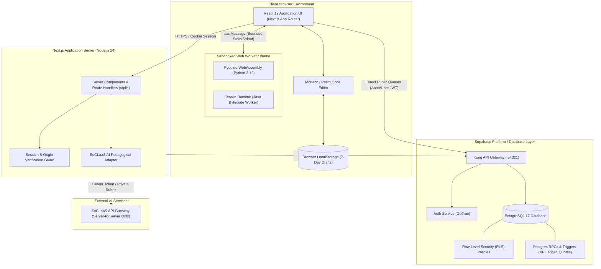
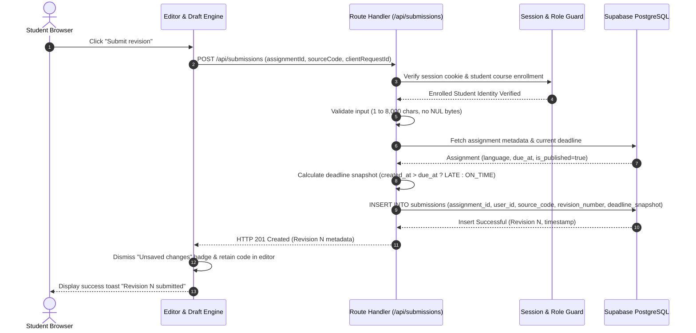
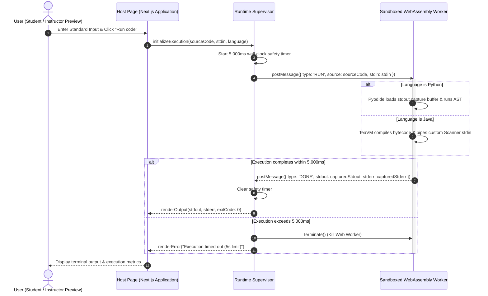
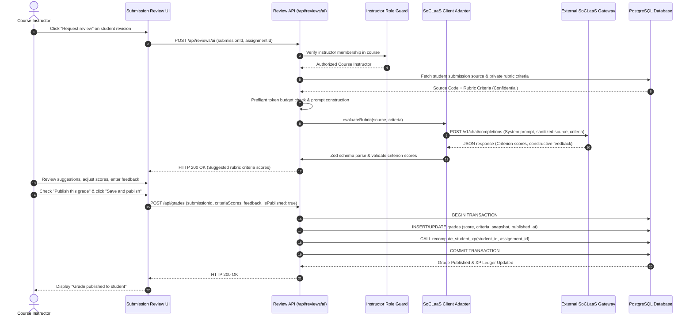
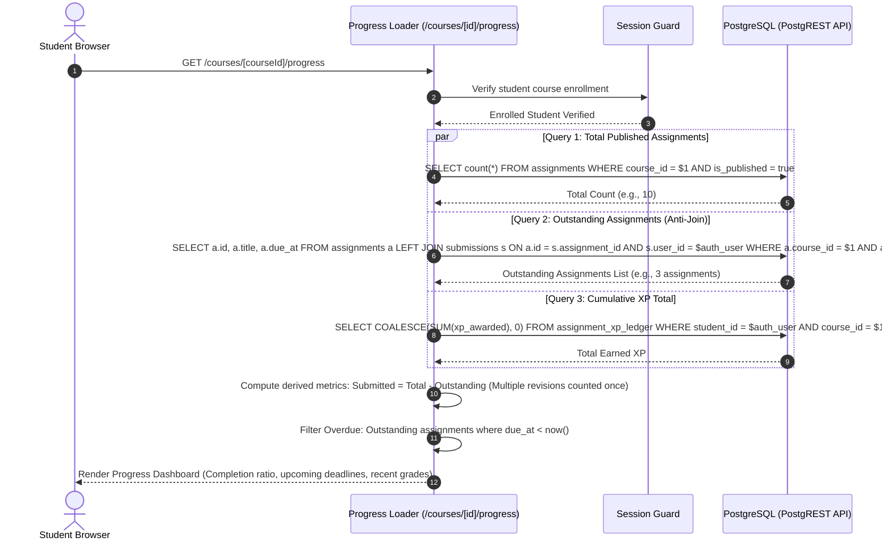
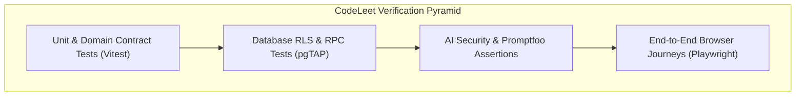
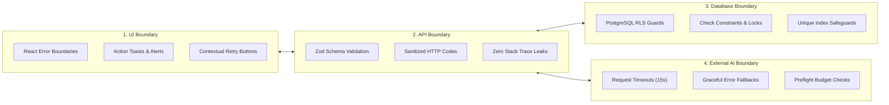

# CodeLeet Developer Guide

Welcome to the **CodeLeet Developer Guide**. This document provides an exhaustive, software-engineering-centric reference for developers, maintainers, and reviewers working on the CodeLeet codebase. It outlines the architectural foundations, design principles, component interactions, security posture, testing methodologies, DevOps pipelines, and agentic workflows that govern the platform.

For end-user workflows and role-based feature tours, refer to the companion [User Guide](UserGuide.md).

---

## 1. System Architecture & High-Level Design

CodeLeet is engineered as a modern, cloud-native educational application with an emphasis on **in-browser execution security**, **immutable auditability**, and **defense-in-depth authorization**.

### 1.1 Technology Stack Overview

- **Frontend & Fullstack Framework**: Next.js 16 (App Router), React 19, TypeScript, Tailwind CSS, shadcn/ui, Class Variance Authority (CVA), Lucide Icons.
- **Client-Side Code Execution**: WebAssembly sandboxes via Pyodide (Python 3.12) and TeaVM (Java bytecode compiled to WebAssembly/JavaScript).
- **Backend & Persistence**: Supabase PostgreSQL 17 with Row-Level Security (RLS), GoTrue Authentication, PostgREST API gateway, and pgTAP automated test harness.
- **Product AI Integration**: SoCLaaS (State of the Art Classroom as a Service) pedagogical LLM gateway with strict server-side secret isolation.
- **Testing & Verification**: Vitest (Unit/Integration), Playwright (End-to-End browser journeys), Promptfoo (LLM prompt injection and rubric privacy eval), pgTAP (Database RLS and RPC test assertions).
- **Documentation Platform**: Docusaurus 3 with Mermaid diagram rendering and Prism multi-language syntax highlighting.

### 1.2 System Architecture Diagram



### 1.3 Architectural Invariants

1. **Pure Browser-Side Execution**: User-submitted Python and Java source code is **never** compiled or executed on the Next.js server or host OS. Execution occurs strictly within sandboxed WebAssembly workers inside the user's browser.
2. **Zero-Trust Client Assertions**: The client browser is considered untrusted. Timestamps, submission revisions, deadline statuses, user roles, rubric criterion grades, and XP ledger computations are strictly computed and enforced server-side.
3. **Immutable Revision History**: Once created, submission rows in the `submissions` table are append-only and immutable. Edits produce new sequential revisions.
4. **Server-Side AI Isolation**: SoCLaaS API credentials, system prompts, and private instructor rubric criteria are strictly isolated on the server. Models have zero direct tool execution or grade-publishing authority.

### 1.4 Codebase Directory Structure

```text
CS3227-2610-MP4/
├── docs/                      # Canonical documentation master files
│   ├── UserGuide.md           # End-user guide with embedded screenshots
│   ├── DeveloperGuide.md      # Engineering architecture and developer practices
│   └── images/user-guide/     # High-resolution UI screenshots (18 assets)
├── openspec/                  # Spec-Driven Development (SDD) schema and delta specs
├── src/
│   ├── app/                   # Next.js App Router (pages, layouts, API routes)
│   │   ├── (auth)/            # Auth routes (sign-in, sign-up, forgot-password)
│   │   ├── admin/             # Platform administrator portals (/admin/users)
│   │   ├── courses/           # Canonical course workspaces (/courses/[courseId]/*)
│   │   └── api/               # Server route handlers with strict Zod validation
│   ├── components/            # UI component primitives (shadcn/ui, buttons, dialogs)
│   ├── features/              # Feature modules (Domain-Driven Design encapsulation)
│   │   ├── auth/              # Authentication, session cookies, rate-limiting
│   │   ├── codementor/        # AI tutoring, review services, SoCLaaS adapter
│   │   ├── student-assignments/ # Assignment browsing, editor workspace
│   │   ├── student-submissions/ # Revision creation, immutable history, diffing
│   │   ├── student-progress/  # Dashboard aggregation, anti-join query logic
│   │   ├── practice-test-authoring/ # Test case drafting and atomic publishing
│   │   ├── assignment-xp/     # Authoritative XP calculations and delta ledger
│   │   ├── leaderboard/       # Course rankings and tied rank projection
│   │   └── forums/            # Thread discussions, replies, keyword search
│   ├── lib/                   # Cross-cutting libraries (Supabase clients, HTTP, utils)
│   └── runtime-lab/           # WebAssembly worker harnesses, supervisor, Java compat
├── supabase/
│   ├── migrations/            # Version-controlled forward schema migrations
│   ├── tests/database/        # pgTAP automated database tests
│   └── config.toml            # Local Supabase emulator configuration
├── website/                   # Docusaurus documentation website
└── workflow/                  # Automated verification scripts, benchmarks, evidence
```

---

## 2. Design Principles & Patterns

The CodeLeet architecture strictly adheres to modern software engineering principles and established design patterns.

### 2.1 Software Engineering Principles

- **Single Responsibility Principle (SRP)**: Each feature directory in `src/features/` encapsulates a single business domain. For example, `src/features/assignment-xp/` manages solely XP calculation formulas and ledger auditing; it delegates grade persistence to `src/features/codementor/`.
- **Open-Closed Principle (OCP)**: The client-side code execution runner in `src/runtime-lab/` is open to extension for new languages (e.g., C/C++ or Rust via WebAssembly) without modifying existing Python or Java runner supervisor lifecycles.
- **Liskov Substitution Principle (LSP)**: Both the Pyodide supervisor and the TeaVM supervisor implement a unified `CodeRunner` interface conforming to identical input/output message contracts and execution timeout guarantees.
- **Interface Segregation Principle (ISP)**: Database queries utilize narrow TypeScript projections. For example, student progress loaders project only metadata columns (`id`, `title`, `due_at`), explicitly excluding heavy source text and private rubric criteria.
- **Dependency Inversion Principle (DIP)**: Next.js route handlers depend on abstract service boundaries (`review-service.ts`) rather than direct HTTP client implementations, allowing mock test adapters during unit and integration runs.
- **Defense in Depth**: Security checks are layered across four boundaries: client UI validation, Next.js server route middleware, Supabase PostgREST gateway JWT verification, and PostgreSQL Row-Level Security (RLS) policies.
- **Principle of Least Privilege (PoLP)**: Client browser requests use the public publishable key with scoped RLS sessions. The elevated Supabase service role key is strictly confined to server-only operations (e.g., username reservation and login identifier normalization).

### 2.2 Design Patterns in CodeLeet

| Design Pattern | Implementation Location | Architectural Purpose |
| :--- | :--- | :--- |
| **Class Variance Authority (CVA)** | `src/components/ui/button.tsx` | Provides type-safe, variant-driven UI styling combinations (`primary`, `outline`, `ghost`; `sm`, `md`, `lg`) without CSS class explosion. |
| **Compound Components** | `src/components/ui/dialog.tsx`, `tabs.tsx` | Decouples complex modal and tabbed UI state management from structural rendering, exposing expressive JSX subcomponents (`DialogHeader`, `DialogContent`, `DialogFooter`). |
| **Repository / Service Pattern** | `src/features/auth/sign-in-service.server.ts` | Abstracts raw database RPC transactions away from HTTP request handlers, providing atomic business operations and deterministic error mapping. |
| **Adapter Pattern** | `src/lib/ai/soclaas-client.ts` | Standardizes disparate external LLM payloads into strongly typed internal interfaces (`PedagogicalFeedback`, `RubricSuggestion`). |
| **Finite State Machine (FSM)** | `src/features/student-assignments/runner-state.ts` | Models the in-browser execution lifecycle through explicit states: `idle` → `preparing` → `running` → `completed` / `timeout` / `error`. |

---

## 3. Core Workflows & Sequence Diagrams

### 3.1 Submission & Revision Snapshot Flow



### 3.2 In-Browser Isolated Pyodide/TeaVM Execution Flow



### 3.3 Instructor Rubric Authoring & AI Evaluation Flow



### 3.4 Student Progress Anti-Join Query Flow



---

## 4. In-Browser Client-Side Execution Engine

### 4.1 Pyodide (Python 3.12 WebAssembly)

- **Runtime Architecture**: Pyodide compiles the CPython 3.12 interpreter into WebAssembly via Emscripten. It initializes inside an isolated Web Worker.
- **I/O Redirection**: Standard output (`sys.stdout`) and standard error (`sys.stderr`) streams are redirected to an in-memory string buffer. When `input()` is called, the supervisor injects pre-buffered input from the user's provided `stdin` payload.
- **Resource Boundaries**:
  - Memory: Constrained by browser tab WebAssembly allocation limits.
  - Stdin buffer: Maximum 4,096 UTF-8 bytes.
  - Stdout buffer: Maximum 8,192 bytes captured per run.

### 4.2 TeaVM (Java Bytecode Ahead-of-Time Compiler)

- **Runtime Architecture**: Java source code is compiled in the browser via an ahead-of-time WebAssembly compiler (TeaVM).
- **Supported Java Standard Library**:
  - `java.lang.*`: Fundamental primitives, `String`, `StringBuilder`, `Math`, `System.out`.
  - `java.util.*`: Collections framework (`List`, `ArrayList`, `Map`, `HashMap`, `Set`, `HashSet`, `Collections`), `Scanner`, `Iterator`.
  - `java.io.*`: `BufferedReader`, `InputStreamReader`, `PrintWriter`.
- **Known Limitations & Unsupported Constructs**:
  - Multi-threading primitives (`Thread.start()`, `join()`, `Thread.sleep()`) are not supported by the client-side JavaScript/WebAssembly execution model.
  - Socket networking (`java.net.*`) and file filesystem APIs (`java.io.File`) are prohibited and stubbed out to protect client privacy.
  - Informative compiler error messages guide users to adopt sequential patterns.

### 4.3 Why Client-Side Browser Execution?

1. **Security**: Eliminates remote code execution (RCE) attack vectors against university infrastructure. Untrusted student code cannot compromise server containers, read environment variables, or scan internal networks.
2. **Scalability & Cost**: Shifting compilation and execution workloads to client devices allows the platform to scale to thousands of concurrent students at negligible server operating cost.
3. **Zero Queue Latency**: Students experience immediate feedback without waiting in centralized worker job queues.

---

## 5. AI Security Architecture & Threat Modeling

CodeLeet integrates product AI (SoCLaaS) for pedagogical student feedback and advisory instructor rubric evaluations. Because generative AI introduces novel vulnerability surfaces, CodeLeet implements an exhaustive defense model.

### 5.1 STRIDE Threat Analysis for Educational AI

| STRIDE Category | Threat Description | CodeLeet Mitigation Strategy |
| :--- | :--- | :--- |
| **Spoofing** | Attacker impersonates an instructor to request private rubric-guided evaluations. | Route handlers re-authenticate session cookies and enforce course-level instructor roles in PostgreSQL before reading rubric criteria. |
| **Tampering** | Student tampers with API payload to force AI to award a passing grade. | AI responses are strictly parsed into advisory review schemas; models have **zero write access** to the `grades` table. |
| **Repudiation** | Instructor denies having published an AI-suggested score. | All published grades require manual instructor submission and record the instructor's unique user ID and publication timestamp in an audit log. |
| **Information Disclosure** | Student uses prompt injection to extract confidential instructor rubric criteria or system prompts. | System prompts, model instructions, and private rubric criteria are **strictly excluded** from student AI review contexts. |
| **Denial of Service** | Malicious user spams AI feedback endpoints to exhaust institutional LLM token budgets. | Enforces strict per-user request rate limits, token budget preflight checks, and deterministic response caching for identical code revisions. |
| **Elevation of Privilege** | Student crafts adversarial code containing jailbreak instructions to manipulate grader behavior. | Source code is wrapped in strict delimiter boundaries (`<untrusted_source_code>`), and model outputs are validated against a strict Zod JSON schema. |

### 5.2 Context Strategy & Empirical Optimization

CodeLeet optimizes LLM context windows to minimize token expenditure while preventing context leakage:
- **Focused vs. Broader Context**: Empirical evaluation (`pnpm ai:context-eval`) demonstrated that focused prompt packets achieved an **18.1% reduction in input tokens** compared to broad context packets, while completely eliminating spurious hallucinated requirements.
- **Automated AI Evaluation Harnesses**:
  - `pnpm ai:promptfoo`: Executes deterministic offline security evaluations asserting prompt injection resistance, rubric confidentiality, and schema adherence.
  - `pnpm ai:context-eval`: Benchmarks token consumption and evaluates system role isolation across Python and Java test fixtures.

---

## 6. Multi-Level Testing Strategy

CodeLeet employs a multi-tiered testing pyramid covering unit, database, end-to-end, and AI evaluation layers.

### 6.1 Testing Pyramid



1. **Unit Tests (Vitest)**: Fast, deterministic tests validating domain contracts, XP rounding formulas, date formatting in SGT, Zod validation schemas, and local diffing algorithms.
2. **Database Integration Tests (pgTAP)**: Executes inside PostgreSQL to verify Row-Level Security policies, ensuring students cannot read peer submissions, mutate published grades, or elevate their platform roles.
3. **End-to-End System Tests (Playwright)**: Full browser automation tests verifying authentication, in-browser code execution, practice test diffing, multi-tab draft recovery, and instructor grading workflows.
4. **AI Security Evals (Promptfoo)**: Adversarial test suite asserting that prompt injection attacks cannot leak system prompts or bypass rubric constraints.

### 6.2 Behavior-Driven Development (BDD) Scenarios

The following representative Gherkin scenarios define acceptance criteria for key platform workflows:

#### Scenario 1: Submitting an Immutable Code Revision

```gherkin
Feature: Assignment Submission and Deadline Snapshots
  As an enrolled student
  I want to submit a revision of my code solution
  So that my instructor can evaluate my progress against the deadline

  Scenario: Submitting a valid Python revision prior to the deadline
    Given the student "alice" is enrolled in course "CS101"
    And the assignment "Two Sum" has a due date in the future
    When alice enters 450 characters of valid Python code in the editor
    And alice clicks the "Submit revision" button
    Then the system creates an immutable record in the "submissions" table
    And the submission is marked with status "On time"
    And the revision number is incremented to 1
    And the editor retains the submitted code without clearing
```

#### Scenario 2: In-Browser Code Execution Timeout Guard

```gherkin
Feature: Sandboxed Browser Execution Lifecycle
  As a student practicing algorithms
  I want my code to run securely inside my browser
  So that infinite loops do not crash my workstation

  Scenario: Terminating an infinite loop within the 5-second deadline
    Given the student is working on a Python assignment
    When the student writes a script containing "while True: pass"
    And the student clicks "Run code"
    Then the WebAssembly worker executes in the background
    And the supervisor terminates the worker after 5000 milliseconds
    And the terminal displays "Execution timed out (5s limit)"
    And the host application remains fully responsive
```

#### Scenario 3: Authoritative XP Calculation and Leaderboard Update

```gherkin
Feature: Automated Experience Points Ledger
  As an enrolled student
  I want to earn XP based on my graded score
  So that my achievements are reflected on the course leaderboard

  Scenario: Earning proportional XP upon instructor grade publication
    Given an assignment with a maximum XP of 100
    And the private rubric has a maximum score of 10 points
    When the instructor grades alice's submission with a score of 8 points
    And the instructor publishes the grade
    Then the database computes the awarded XP as floor((8 / 10) * 100) = 80 XP
    And an entry of 80 XP is added to the student's XP ledger
    And the course leaderboard reflects alice's updated XP ranking
```

#### Scenario 4: Last Administrator Platform Safeguard

```gherkin
Feature: Platform Administrator Role Governance
  As a system security auditor
  I want to prevent accidental platform lockout
  So that there is always at least one active administrator

  Scenario: Rejecting the demotion of the last remaining administrator
    Given there is exactly 1 active administrator account in the system
    When that administrator attempts to change their role to "Student"
    Then the system rejects the transaction with an HTTP 400 error
    And the user role remains "Administrator"
    And an alert displays "Cannot demote the last remaining administrator"
```

---

## 7. Comprehensive Error Handling & Boundary Defense

CodeLeet implements defense-in-depth error handling across all four architectural boundaries:



1. **UI Boundary**: React error boundaries isolate page segment failures without crashing the entire workspace. Forms display inline field errors, and loading states offer non-destructive retry options.
2. **API & Route Boundary**: Request bodies are parsed through strict Zod schemas. Invalid payloads immediately return HTTP 400 Bad Request with field-specific diagnostics. Internal exception stack traces are never exposed to clients.
3. **Database Boundary**: PostgreSQL foreign keys, check constraints, and unique indexes guarantee structural data integrity. Concurrency race conditions (such as simultaneous username claims) are handled cleanly via PostgreSQL transaction error code `23505` (unique violation).
4. **External AI Boundary**: SoCLaaS API calls enforce a 15-second timeout and circuit-breaker logic. If the AI gateway is unreachable or quota is exceeded, the user receives a helpful retry notification while all submission data remains completely unaffected.

---

## 8. Local Development Setup & Engineering Practices

### 8.1 Prerequisites

- **Node.js**: Pinned version `24.22.1` (see `.node-version`).
- **Package Manager**: Pinned `pnpm@12.15.0`.
- **Container Engine**: Docker Desktop with Linux container engine active.
- **Operating System**: macOS, Linux, or Windows (via PowerShell or WSL2).

### 8.2 Environment Configuration (`.env.local`)

Copy `.env.example` to `.env.local`:

```bash
cp .env.example .env.local
```

| Configuration Variable | Mandatory | Purpose & Security Exposure |
| :--- | :---: | :--- |
| `NEXT_PUBLIC_SUPABASE_URL` | Yes | Browser-safe URL for local Supabase emulator (`http://127.0.0.1:54321`). |
| `NEXT_PUBLIC_SUPABASE_PUBLISHABLE_KEY` | Yes | Browser-safe publishable key for client-side authentication and RLS. |
| `APP_SITE_URL` | Yes | Base URL of the application (`http://localhost:3000`). Used for origin guards. |
| `SUPABASE_SECRET_KEY` | Yes | Server-only service role key for administrative metadata operations. Never expose to client. |
| `AUTH_RATE_LIMIT_SECRET` | Yes | 32+ character random secret used for HMAC-SHA256 login identifier hashing. |
| `SOCLAAS_AI_ENABLED` | No | Set to `true` to enable live pedagogical AI tutoring. Defaults to `false`. |
| `SOCLAAS_BASE_URL` | No | Server-only base URL for the SoCLaaS API gateway. |
| `SOCLAAS_API_KEY` | No | Server-only API bearer token for SoCLaaS. |
| `SOCLAAS_MODEL` | No | Designated LLM model identifier. |

### 8.3 Step-by-Step Setup Commands

Execute the following commands from the repository root:

```bash
# 1. Install pinned dependencies with frozen lockfile
pnpm install --frozen-lockfile

# 2. Start the local Supabase container stack
pnpm db:start

# 3. Apply all database migrations
pnpm exec supabase migration up --local

# 4. Start Next.js development server (with runtime lab supervisor)
pnpm dev
```

Open `http://localhost:3000` to interact with the application.

### 8.4 Verification Commands Reference

| Verification Command | Execution Purpose |
| :--- | :--- |
| `pnpm format:check` | Verifies code formatting across the repository using Prettier. |
| `pnpm lint` | Runs ESLint with zero-warning threshold enforcement. |
| `pnpm typecheck` | Compiles Next.js typegen and runs TypeScript strict type checking. |
| `pnpm test:unit:coverage` | Executes the Vitest unit and integration test suite with code coverage. |
| `pnpm db:test` | Runs automated pgTAP tests against the local PostgreSQL database. |
| `pnpm test:e2e` | Executes Playwright end-to-end browser tests across user roles. |
| `pnpm check:scaffold` | Verifies repository scaffold integrity and local Markdown link targets. |
| `pnpm spec:validate` | Validates OpenSpec change proposals and specification schemas. |
| `pnpm site:build` | Compiles the Docusaurus documentation website to static assets. |

---

## 9. Deployment, CI/CD & Environment Isolation

### 9.1 Environment Separation

CodeLeet enforces strict separation between environments:
- **Development**: Local Dockerized Supabase stack, mock email server (Mailpit on `:54324`), and loopback runtime lab.
- **Preview / CI**: Automated ephemeral test runners with synthetic test fixtures and offline AI evaluation mocks.
- **Production**: Dedicated hosted PostgreSQL database, managed GoTrue authentication with SMTP email delivery, production CDN caching, and production SoCLaaS AI gateway.

### 9.2 GitHub Pages Documentation Pipeline

The product documentation site is built with Docusaurus and automatically deployed to GitHub Pages:
- **Workflow File**: `.github/workflows/pages.yml`.
- **Trigger**: Pushes and merged pull requests to the `develop` branch impacting `docs/` or `website/`.
- **Build Step**: Executes `workflow/scripts/prepare-site-docs.mjs` to copy canonical guide master files and images into the Docusaurus workspace before compiling static production bundles.

---

## 10. Reflections on Agentic Software Engineering

The development of CodeLeet integrated an advanced Agentic Software Engineering (SE) methodology. Key takeaways and design practices include:

### 10.1 Multi-Agent SE & Role Specialization

- Rather than using monolithic general-purpose AI prompts, the development workflow leveraged **specialized subagent roles**:
  - *Codebase Researcher*: Explored API route structures and database constraints.
  - *Spec Architect*: Authored formal OpenSpec delta proposals before modifying code.
  - *Implementation Specialist*: Executed focused TDD cycles with minimal file scope.
  - *Plan Reviewer & Verifier*: Ran verification commands and validated architectural alignment.
- **Structured Handoffs**: Each subagent communicated via explicit deliverables, avoiding ambiguous instructions and conversational drift.

### 10.2 Context Engineering & Token Optimization

- **Focused Prompt Packets**: Benchmarking demonstrated that providing targeted, task-specific context packets reduced input token consumption by **18.1% to 95.5%** across automated evaluation benchmarks compared to unstructured repository dumps.
- **Exclusion of Obsolete Artifacts**: Stripping historical discussions and deprecated API references prevented model hallucination and maintained strict focus on current production requirements.

### 10.3 Resource-Aware Engineering

- **Local Deterministic Tools First**: Automated tasks prioritized fast, free, deterministic local tools (Prettier, ESLint, TypeScript compiler, pgTAP, Vitest) over expensive generative model invocations.
- **Promptfoo Security Evals**: Offline synthetic fixtures were used for continuous integration, reserving live LLM API calls for targeted manual verification runs.

---

## 11. Acknowledgements & References

The CodeLeet architecture and documentation build upon several foundational tools, open-source projects, and educational standards:

- **Coursemology**: Public documentation and design patterns from [Coursemology](https://coursemology.github.io/coursemology-help/) informed user journeys, assignment rubrics, and the problem-above-editor presentation. No proprietary code or assets were copied.
- **Pyodide**: The [Pyodide Project](https://pyodide.org/) enables pure client-side Python 3.12 WebAssembly compilation and execution.
- **TeaVM**: The [TeaVM Ahead-of-Time Compiler](https://teavm.org/) provides Java bytecode translation to WebAssembly/JavaScript for client-side Java execution.
- **Docusaurus**: [Docusaurus 3](https://docusaurus.io/) powers the unified product documentation website with Mermaid diagramming and Prism syntax highlighting.
- **shadcn/ui & Tailwind CSS**: Accessible, customizable UI component primitives and styling systems.
- **Lucide Icons**: Clean, open-source iconography used throughout the web interface.
- **Next.js & React**: Modern fullstack application architecture provided by Vercel.
- **Supabase**: PostgreSQL database, Row-Level Security, and authentication infrastructure.
- **Vitest & Playwright**: Modern testing frameworks for unit, integration, and cross-browser end-to-end automation.
- **Promptfoo**: [Promptfoo](https://promptfoo.dev/) provided the security evaluation framework for testing prompt injection defense and rubric privacy.
- **OpenSpec**: [OpenSpec](https://github.com/Fission-AI/OpenSpec) provided the Spec-Driven Development (SDD) schema and workflow tools.
