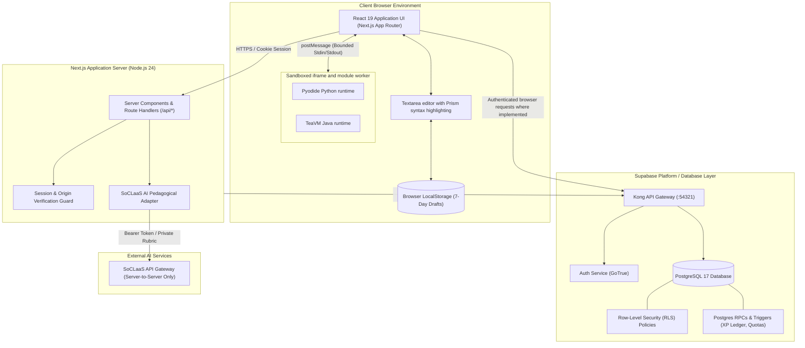
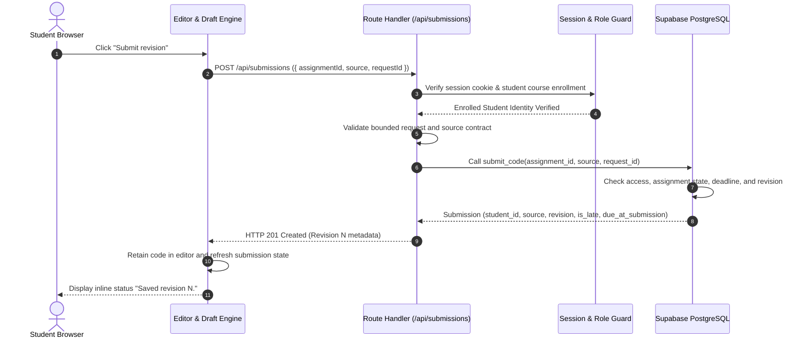
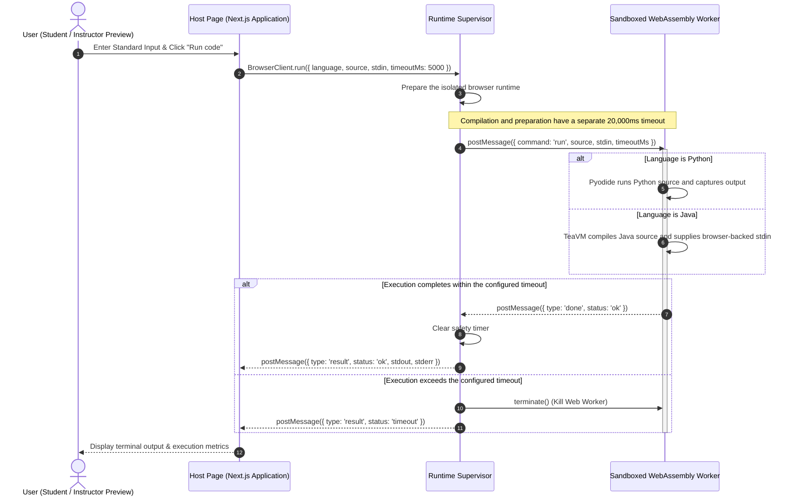
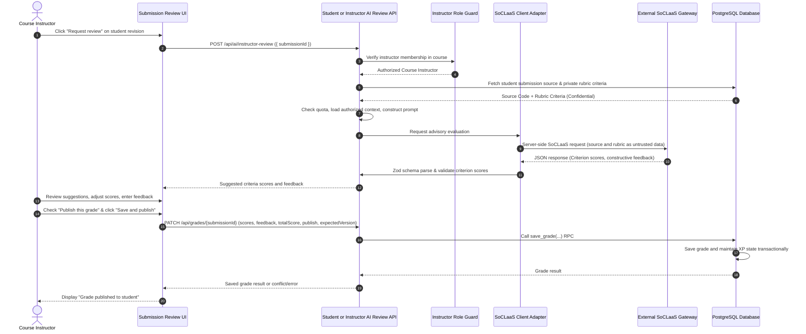
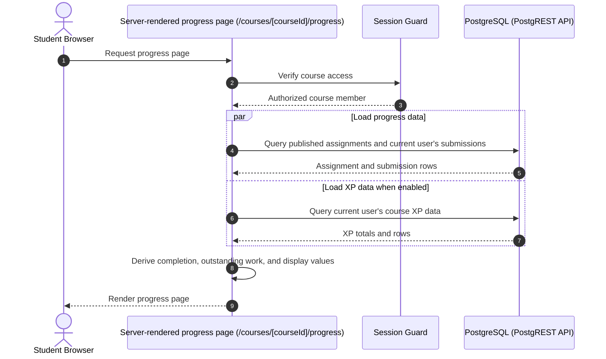
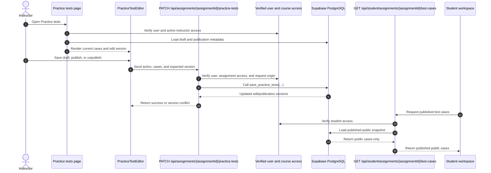
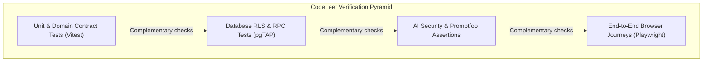
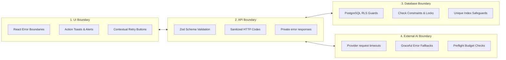

# CodeLeet Developer Guide

Welcome to the **CodeLeet Developer Guide**. This guide summarizes the implemented architecture, development setup, verification commands, and recorded workflow practices. Source code, migrations, tests, and dated workflow evidence remain authoritative when implementation details change.

For end-user workflows and role-based feature tours, refer to the companion [User Guide](UserGuide.md).

---

## 1. System Architecture & High-Level Design

CodeLeet is a Next.js educational application backed by Supabase. Python and Java submissions execute in a browser runtime; application data and AI review requests use server routes and Supabase policies. These controls reduce specific risks but do not establish that the system is risk-free.

### 1.1 Technology Stack Overview

- **Frontend & Fullstack Framework**: Next.js 16 (App Router), React 19, TypeScript, Tailwind CSS, shadcn/ui, Class Variance Authority (CVA), Lucide Icons.
- **Client-Side Code Execution**: Browser runtime modules use Pyodide for Python and TeaVM for Java source compilation and execution.
- **Backend & Persistence**: Supabase PostgreSQL 17 with Row-Level Security (RLS), GoTrue Authentication, PostgREST API gateway, and pgTAP automated test harness.
- **Product AI Integration**: SoCLaaS (State of the Art Classroom as a Service) pedagogical LLM gateway with strict server-side secret isolation.
- **Testing & Verification**: Vitest, Playwright, Promptfoo, and pgTAP are present for different application and database checks. See the commands and current workflow records for what has actually been run.
- **Documentation Platform**: Docusaurus 3 with Mermaid diagram rendering and Prism multi-language syntax highlighting.

### 1.2 System Architecture Diagram



### 1.3 Architectural Invariants

1. **Browser-Side Execution**: The application does not send submitted code to a server execution API. The browser runtime runs it in an iframe and worker. Source can still be submitted to the application or sent in a server-side AI review request when the user invokes those features.
2. **Server-Validated State**: The browser is not the authority for protected writes. Supabase Auth session state is verified with `auth.getUser()` in protected server operations; role, ownership, and membership checks then use server-side lookups and database policies/functions. Submission metadata, grade changes, and XP effects are checked by server routes and database functions/policies, as defined by the current implementation.
3. **Revision History**: Submissions are created through the `submit_code` database function with revision and deadline data. The application presents revisions as history; database rules and tests define the enforced write behavior.
4. **Server-Side AI Isolation**: SoCLaaS API credentials, system prompts, and private instructor rubric criteria are strictly isolated on the server. Models have zero direct tool execution or grade-publishing authority.

### 1.4 Codebase Directory Structure

Selected repository paths:

```text
CS3227-2610-MP4/
├── docs/                      # Canonical documentation master files
│   ├── UserGuide.md           # End-user guide with embedded screenshots
│   ├── DeveloperGuide.md      # Engineering architecture and developer practices
│   └── images/user-guide/     # User-guide screenshots (18 image assets)
├── openspec/                  # Spec-Driven Development (SDD) schema and delta specs
├── src/
│   ├── app/                   # Selected Next.js App Router routes and API handlers
│   │   ├── auth/              # Invitation acceptance and auth callback routes
│   │   ├── admin/             # User roles (/admin) and read-only course metadata
│   │   ├── courses/           # Canonical course workspaces (/courses/[courseId]/*)
│   │   ├── sign-in/, sign-up/ # Authentication pages
│   │   ├── forgot-password/, reset-password/
│   │   └── api/               # Server route handlers
│   ├── components/            # Shared layout and UI components
│   ├── features/              # Selected feature-focused application modules
│   │   ├── auth/              # Authentication, session cookies, rate-limiting
│   │   ├── codementor/        # AI tutoring, review services, SoCLaaS adapter
│   │   ├── student-assignments/ # Assignment browsing, editor workspace
│   │   ├── student-submissions/ # Revision creation, immutable history, diffing
│   │   ├── student-progress/  # Server-side progress and activity loaders
│   │   ├── practice-test-authoring/ # Test case drafting and atomic publishing
│   │   ├── assignment-xp/     # Authoritative XP calculations and delta ledger
│   │   ├── leaderboard/       # Course rankings and tied rank projection
│   │   └── forums/            # Thread discussions, replies, keyword search
│   ├── lib/                   # Cross-cutting libraries (Supabase clients, HTTP, utils)
│   └── runtime-lab/           # WebAssembly worker harnesses, supervisor, Java compat
├── supabase/
│   ├── migrations/            # Version-controlled forward schema migrations
│   ├── tests/database/        # pgTAP automated database tests
│   └── config.toml            # Local Supabase emulator configuration
├── website/                   # Docusaurus documentation website
└── workflow/                  # Automated verification scripts, benchmarks, evidence
```

---

## 2. Design Principles & Patterns

The codebase uses feature-oriented modules and explicit server, database, and browser-runtime boundaries. The examples below describe current boundaries rather than claiming formal adherence to every design principle.

### 2.1 Software Engineering Principles

- **Feature modules**: `src/features/` groups related contracts, queries, and UI by product area; module boundaries differ by feature.
- **Server and database boundaries**: Route handlers authenticate requests and call Supabase using user-scoped or server-only clients. Database policies and functions enforce the rules defined in migrations.
- **Browser runtime boundary**: `src/runtime-lab/` runs code in a browser iframe and worker, separate from the Next.js server.

### 2.2 Design Patterns in CodeLeet

| Design Pattern | Implementation Location | Architectural Purpose |
| :--- | :--- | :--- |
| **Provider client** | `src/lib/ai/soclaas.ts` | Sends server-side requests to SoCLaaS and parses provider responses. |
| **Review service** | `src/features/codementor/review-service.ts` | Coordinates review context, quota/cache operations, provider calls, and result persistence. |
| **Browser runtime** | `src/runtime-lab/lab.mjs`, `supervisor.mjs`, `worker.mjs` | Runs user code in the browser runtime boundary and communicates output to the application. |

---

## 3. Core Workflows & Sequence Diagrams

### 3.1 Submission & Revision Snapshot Flow



### 3.2 In-Browser Isolated Pyodide/TeaVM Execution Flow



### 3.3 Instructor Rubric Authoring & AI Evaluation Flow



### 3.4 Student Progress Page Data Flow



### 3.5 Practice-Test Authoring & Publication Flow

The instructor route `/courses/[courseId]/assignments/[assignmentId]/practice-tests` is the dedicated view for managing a saved test set and publishing its student-visible snapshot. The current assignment list and edit form do not link to this route; the route itself links back to the edit form. The edit form also exposes the same cases. The student assignment workspace instead loads published public cases in its **Test cases** panel and runs them in the browser.



The assignment create/edit form (`AssignmentForm` and `TestCasesFields`) supports up to 25 cases and exposes the **Public**/**Private** toggle. The dedicated editor changes case names and input/output, but has no visibility control. Its **Add test case** button displays **Up to 5 cases** and disables when the current set contains exactly five, while the shared request schema accepts case sets up to 25. Use the assignment form to add cases 6–25 or change visibility. Saving that form with assignment status `published` immediately refreshes the public snapshot with the public cases in the form; the dedicated page's **Save draft** action leaves the published snapshot unchanged until **Publish tests** is selected. Private cases remain in the instructor draft and are filtered out of the public snapshot; the current app does not provide a private-case runner in submission review. The assignment-form helper text currently says private cases are used for instructor evaluation, so that UI copy is inconsistent with the implemented runner flow.

---

## 4. In-Browser Client-Side Execution Engine

### 4.1 Pyodide (Python 3.12 WebAssembly)

- **Runtime Architecture**: The browser runtime initializes Pyodide in its worker-based execution flow. Runtime assets are loaded by the application as needed.
- **I/O Redirection**: Standard output (`sys.stdout`) and standard error (`sys.stderr`) streams are redirected to an in-memory string buffer. When `input()` is called, the supervisor injects pre-buffered input from the user's provided `stdin` payload.
- **Resource Boundaries**: Input/output bounds and execution limits are implemented in the runtime. Their values and behavior are maintained in `src/runtime-lab/`; browser and device resource limits still apply.

### 4.2 TeaVM (Java Bytecode Ahead-of-Time Compiler)

- **Runtime Architecture**: Java source compilation and execution happen in the browser using TeaVM and the project’s Java support classes.
- **Compatibility**: Common introductory APIs such as `System.out`, `Scanner`, `BufferedReader`, and collections are supported by the bundled runtime. Compatibility depends on the TeaVM runtime and project support classes; this is not a complete Java SE implementation.
- **Known Limitation**: The browser runner does not support Java multithreading. Consult `src/runtime-lab/` and the runtime tests for the current supported behavior.

### 4.3 Why Client-Side Browser Execution?

1. **Execution location**: Student code is run by the browser runtime instead of a remote execution service. This avoids executing submissions on the application server; it does not eliminate all browser or application risks.
2. **Work distribution**: Compilation and execution use the student's browser resources. Performance depends on the device and browser.
3. **Runtime feedback**: The application does not use a centralized execution queue for these browser runs.

---

## 5. AI Security Architecture & Threat Modeling

CodeLeet integrates SoCLaaS for student feedback and advisory instructor rubric suggestions. The following table describes implemented controls and their limits; it is not an exhaustive security guarantee.

### 5.1 STRIDE Threat Analysis for Educational AI

| STRIDE Category | Threat Description | CodeLeet Mitigation Strategy |
| :--- | :--- | :--- |
| **Spoofing** | Attacker impersonates an instructor to request private rubric-guided evaluations. | Route handlers re-authenticate session cookies and enforce course-level instructor roles in PostgreSQL before reading rubric criteria. |
| **Tampering** | Student tampers with API payload to force AI to award a passing grade. | AI responses are strictly parsed into advisory review schemas; models have **zero write access** to the `grades` table. |
| **Repudiation** | Instructor denies having published a grade. | Grade records include instructor attribution, publication timestamp, and version fields. |
| **Information Disclosure** | A student attempts to obtain private rubric data through student review. | Student and instructor review paths construct different contexts; the student context omits private rubric criteria. This does not prove resistance to every model or provider disclosure risk. |
| **Denial of Service** | Repeated AI requests consume quota or provider capacity. | AI review code includes quota reservation, request limits, and caching controls. Limits apply as implemented by the current routes and database functions. |
| **Elevation of Privilege** | Untrusted source attempts to change model behavior or publish a grade. | System prompts identify assignment text, source, and rubric text as untrusted data; response schemas are validated. Models do not publish grades: an instructor must save a grade through the grade route. These measures do not guarantee prompt-injection resistance. |

### 5.2 Context Strategy & Empirical Optimization

CodeLeet includes an offline context-comparison experiment. Its result measures serialized prompt-size estimates for a small synthetic fixture set; it does not measure live provider usage, response quality, hallucinations, or security effectiveness.
- **Focused vs. Broader Context**: The recorded evaluation reports an **18.1% aggregate estimated input-token reduction across eight synthetic cases**. It estimates tokens as `ceil(UTF-8 bytes / 3)` and checks prompt structure; it does not call a model. Results for an individual review can differ.
- **Automated AI Evaluation Harnesses**:
  - `pnpm ai:promptfoo`: Runs the configured Promptfoo evaluation suite; inspect its tests and current run evidence for the assertions covered.
  - `pnpm ai:context-eval`: Runs the repository's offline context comparison experiment; it is not a live model quality benchmark.

---

## 6. Verification Strategy

The repository contains several complementary verification layers. Their presence does not mean every layer runs on every change.

### 6.1 Testing Pyramid



1. **Unit and component tests (Vitest)**: Test selected domain contracts and UI behavior.
2. **Database tests (pgTAP)**: Check selected database functions, policies, and constraints in the test database.
3. **Browser tests (Playwright)**: Exercise selected user flows in a browser.
4. **AI evaluations (Promptfoo and local tests)**: Check selected prompt and response cases. Passing these cases does not prove prompt-injection resistance.

### 6.2 Illustrative Workflow Scenarios

The following examples describe intended behavior for key workflows. They are illustrative documentation, not executable Gherkin tests or a complete acceptance specification. For executable assertions, see the corresponding tests and migrations.

#### Scenario 1: Submitting an Immutable Code Revision

```gherkin
Feature: Assignment Submission and Deadline Snapshots
  As an enrolled student
  I want to submit a revision of my code solution
  So that my instructor can evaluate my progress against the deadline

  Scenario: Submitting a valid Python revision prior to the deadline
    Given the student "alice" is enrolled in course "CS101"
    And the assignment "Two Sum" has a due date in the future
    When alice enters 450 characters of valid Python code in the editor
    And alice clicks the "Submit revision" button
    Then the system creates an immutable record in the "submissions" table
    And the submission is marked with status "On time"
    And the revision number is incremented to 1
    And the editor retains the submitted code without clearing
```

#### Scenario 2: In-Browser Code Execution Timeout Guard

```gherkin
Feature: Sandboxed Browser Execution Lifecycle
  As a student practicing algorithms
  I want my code to run securely inside my browser
  So that infinite loops do not crash my workstation

  Scenario: Terminating an infinite loop after its 5-second execution budget
    Given the student is working on a Python assignment
    When the student writes a script containing "while True: pass"
    And the student clicks "Run code"
    Then the WebAssembly worker executes in the background
    And the run reports a timeout when the execution budget expires
    And the host application remains fully responsive
```

#### Scenario 3: Authoritative XP Calculation and Leaderboard Update

```gherkin
Feature: Automated Experience Points Ledger
  As an enrolled student
  I want to earn XP based on my graded score
  So that my achievements are reflected on the course leaderboard

  Scenario: Earning proportional XP upon instructor grade publication
    Given an assignment with a maximum XP of 100 and course XP is enabled
    And the private rubric has a maximum score of 10 points
    When the instructor grades alice's submission with a score of 8 points
    And the instructor publishes the grade
    Then the database computes the awarded XP as floor((8 / 10) * 100) = 80 XP
    And an entry of 80 XP is added to the student's XP ledger
    And the course leaderboard reflects alice's updated XP ranking
```

#### Scenario 4: Last Administrator Platform Safeguard

```gherkin
Feature: Platform Administrator Role Governance
  As a system security auditor
  I want to prevent accidental platform lockout
  So that there is always at least one active administrator

  Scenario: Rejecting the demotion of the last remaining administrator
    Given there is exactly 1 active administrator account in the system
    When that administrator attempts to change their role to "Student"
    Then the system rejects the transaction with an HTTP 409 error
    And the user role remains "Administrator"
    And an alert displays "Cannot demote the last remaining administrator"
```

---

## 7. Error Handling & Boundary Defense

The application handles errors at UI, route, database, and provider boundaries. Exact validation and response behavior is route-specific.



1. **UI Boundary**: Forms and page components provide validation and error states where implemented. Behavior differs by workflow.
2. **API & Route Boundary**: Routes apply request parsing, validation, authorization, and route-specific error mapping. Do not assume every route returns the same status or field diagnostics.
3. **Database Boundary**: Migrations define constraints, policies, and database functions for protected operations. Tests cover selected cases.
4. **External AI Boundary**: The SoCLaaS client applies a request timeout. Routes map provider, quota, and validation failures to user-facing responses; exact behavior depends on the route.

---

## 8. Local Development Setup & Engineering Practices

### 8.1 Prerequisites

- **Node.js**: Pinned version `24.22.1` (see `.node-version`).
- **Package Manager**: Pinned `pnpm@12.15.0`.
- **Container Engine**: Docker Desktop with Linux container engine active.
- **Operating System**: macOS, Linux, or Windows (via PowerShell or WSL2).

### 8.2 Environment Configuration (`.env.local`)

Copy `.env.example` to `.env.local`:

```bash
cp .env.example .env.local
```

| Configuration Variable | Mandatory | Purpose & Security Exposure |
| :--- | :---: | :--- |
| `NEXT_PUBLIC_SUPABASE_URL` | Yes | Browser-safe URL for local Supabase emulator (`http://127.0.0.1:54321`). |
| `NEXT_PUBLIC_SUPABASE_PUBLISHABLE_KEY` | Yes | Browser-safe publishable key for client-side authentication and RLS. |
| `APP_SITE_URL` | Yes | Base URL of the application (`http://localhost:3000`). Used for origin guards. |
| `SUPABASE_SECRET_KEY` | Yes | Server-only Supabase secret key used by privileged server operations. Never expose to client. |
| `AUTH_RATE_LIMIT_SECRET` | Yes | 32+ character random secret used for HMAC-SHA256 login identifier hashing. |
| `SOCLAAS_AI_ENABLED` | No | Set to `true` to enable live pedagogical AI tutoring. Defaults to `false`. |
| `SOCLAAS_BASE_URL` | No | Server-only base URL for the SoCLaaS API gateway. |
| `SOCLAAS_API_KEY` | No | Server-only API bearer token for SoCLaaS. |
| `SOCLAAS_MODEL` | No | Designated LLM model identifier. |

### 8.3 Step-by-Step Setup Commands

Execute the following commands from the repository root:

```bash
# 1. Install pinned dependencies with frozen lockfile
pnpm install --frozen-lockfile

# 2. Start the local Supabase container stack
pnpm db:start

# 3. Apply all database migrations
pnpm exec supabase migration up --local

# 4. Start Next.js development server (with runtime lab supervisor)
pnpm dev
```

Open `http://localhost:3000` to interact with the application.

### 8.4 Verification Commands Reference

| Verification Command | Execution Purpose |
| :--- | :--- |
| `pnpm format:check` | Verifies code formatting across the repository using Prettier. |
| `pnpm lint` | Runs ESLint with zero-warning threshold enforcement. |
| `pnpm typecheck` | Compiles Next.js typegen and runs TypeScript strict type checking. |
| `pnpm test:unit:coverage` | Executes the Vitest unit and integration test suite with code coverage. |
| `pnpm db:test` | Runs automated pgTAP tests against the local PostgreSQL database. |
| `pnpm test:e2e` | Executes Playwright end-to-end browser tests across user roles. |
| `pnpm check:scaffold` | Verifies repository scaffold integrity and local Markdown link targets. |
| `pnpm spec:validate` | Validates OpenSpec change proposals and specification schemas. |
| `pnpm site:build` | Compiles the Docusaurus documentation website to static assets. |

---

## 9. Deployment, CI/CD & Environment Isolation

### 9.1 Environments and Deployed Branches

The repository supports local development and CI checks. The project owner confirms these deployed branch mappings:

| Branch | Deployment | URL |
| :--- | :--- | :--- |
| `develop` | Vercel Preview | [dev-cs3227-mp4.johnwz123.me](https://dev-cs3227-mp4.johnwz123.me/) |
| `master` | Vercel Production | [cs3227-mp4.vercel.app](https://cs3227-mp4.vercel.app/) |

These deployment details are owner-confirmed. Deployment alone does not document or prove a hosted acceptance run, migration status, operational configuration, or release sign-off.

### 9.2 GitHub Pages Documentation Pipeline

The product documentation site is built with Docusaurus and automatically deployed to GitHub Pages:
- **Workflow File**: `.github/workflows/pages.yml`.
- **Trigger**: Manual dispatch on `develop`, or a push to `develop` that changes one of the paths listed in `.github/workflows/pages.yml` (including the canonical guides, `website/`, and site build configuration). Pull requests do not deploy directly; a matching merge triggers the push workflow.
- **Build Step**: Executes `workflow/scripts/prepare-site-docs.mjs` to copy canonical guide master files and images into the Docusaurus workspace before compiling static production bundles.

---

## 10. Reflections on Agentic Software Engineering

The development of CodeLeet integrated an advanced Agentic Software Engineering (SE) methodology. Key takeaways and design practices include:

### 10.1 Multi-Agent SE & Role Specialization

- The repository workflow defines specialist roles and scoped handoffs for research, planning, implementation, and review. Session logs and evidence files record where those roles were actually used; this was not a universal process for every task.
- **Structured Handoffs**: The workflow records scoped tasks, evidence, and review outcomes where applicable. Consult dated logs rather than assuming every handoff followed the same pattern.

### 10.2 Context Engineering & Token Optimization

- **Context Size Experiments**: Two offline size experiments use a byte-based estimator. The product AI context experiment reports an 18.1% aggregate estimated reduction across eight synthetic cases. A separate constructed development-context experiment reports 95.5% fewer estimated tokens in five focused packets than in deliberately broad packets. Neither result measures live model usage, quality, agent performance, latency, or cost; see the linked experiment records for methodology and limits.
- **Exclusion of Obsolete Artifacts**: The constructed development-context experiment deliberately included nine obsolete references in broad packets and omitted them from focused packets. It did not test whether agents would follow those references or reduce errors.

### 10.3 Resource-Aware Engineering

- **Local Deterministic Tools First**: Automated tasks prioritized fast, free, deterministic local tools (Prettier, ESLint, TypeScript compiler, pgTAP, Vitest) over expensive generative model invocations.
- **Promptfoo Security Evals**: Offline synthetic fixtures were used for continuous integration, reserving live LLM API calls for targeted manual verification runs.

---

## 11. Acknowledgements & References

The CodeLeet architecture and documentation build upon several foundational tools, open-source projects, and educational standards:

- **Coursemology**: The project brief and design record cite [Coursemology's public help pages](https://coursemology.github.io/coursemology-help/) and user-supplied screenshots as references for feature journeys and page layout.
- **Pyodide**: The [Pyodide Project](https://pyodide.org/) enables pure client-side Python 3.12 WebAssembly compilation and execution.
- **TeaVM**: The [TeaVM Ahead-of-Time Compiler](https://teavm.org/) provides Java bytecode translation to WebAssembly/JavaScript for client-side Java execution.
- **Docusaurus**: [Docusaurus 3](https://docusaurus.io/) powers the unified product documentation website with Mermaid diagramming and Prism syntax highlighting.
- **shadcn tooling, Tailwind CSS & CVA**: The repository includes shadcn configuration, Tailwind styling, and CVA variants for shared components.
- **Lucide Icons**: Lucide React supplies icons used in the interface.
- **Next.js & React**: Next.js provides the application framework; React renders interactive UI.
- **Supabase**: PostgreSQL database, Row-Level Security, and authentication infrastructure.
- **Vitest & Playwright**: Testing frameworks used for unit/component checks and browser-based end-to-end automation.
- **Promptfoo**: The repository's [Promptfoo](https://promptfoo.dev/) command runs the configured offline prompt-evaluation fixtures. Passing them checks only their selected cases and does not establish model resistance.
- **OpenSpec**: [OpenSpec](https://github.com/Fission-AI/OpenSpec) provided the Spec-Driven Development (SDD) schema and workflow tools.
