# CodeLeet User Guide

Welcome to **CodeLeet**, a modern educational coding and assessment platform designed for computer science students, instructors, and administrators. CodeLeet provides an interactive, in-browser learning environment for **Python** and **Java**, featuring automated practice test execution, seamless local draft recovery, immutable revision histories, pedagogical AI feedback, gamified experience points (XP), discussion forums, and robust rubric-based evaluation workflows.

This guide provides an end-to-end walkthrough of all user-facing capabilities in CodeLeet. It is written specifically for end users and peer testers.

---

## 1. Quick Navigation & Role Architecture

CodeLeet uses a two-tier role architecture that clearly separates **Platform Account Roles** (system-wide privileges) from **Course Membership Roles** (permissions within a specific course workspace). This decoupling ensures you can have different responsibilities across different courses (for example, serving as a course instructor in one course while being enrolled as a student in another).

### 1.1 Platform Account Roles (Global Scope)

Platform roles govern system-wide account authority, course creation privileges, and institutional administration:

| Platform Role | Default Upon Registration | Primary System Authority & Responsibilities |
| :--- | :---: | :--- |
| **Platform Student** | Yes (Default) | Standard account tier. Can view enrolled courses, join active courses via student join codes, solve published assignments, participate in course discussion forums, and track earned XP. |
| **Platform Instructor** | No (Requires Promotion) | Elevated staff tier. Authorized to create and configure new course workspaces, author assignments and private rubrics, grade student submissions, invite course staff, and serve as Course Owner. |
| **Platform Administrator** | No (Protected Safeguard) | Highest platform governance tier. Authorized to manage user platform roles (`/admin`), reassign unowned legacy course archives, and inspect institutional metadata. Protected against demoting the final administrator. |

> [!NOTE] Default Account Role & Instructor Promotion
> For security, access governance, and academic integrity reasons, all self-registered user accounts are automatically provisioned with the **Platform Student** role by default.
>
> If you are a course lecturer, professor, teaching assistant, or academic staff member requiring **Platform Instructor** privileges (to create new courses, author assignments, or grade student submissions), please contact the Platform Administrator at **`johnwong@u.nus.edu`** with your course details and institutional email to have your platform account role promoted.

### 1.2 Course Membership Roles (Course-Scoped)

Within any individual course workspace, members hold granular course-level roles that determine their pedagogical permissions for that specific course:

| Course Role | Enrollment / Assignment Method | Course Workspace Capabilities |
| :--- | :--- | :--- |
| **Course Student** | Enrolled with a student join code or direct course invitation after verified sign-in | Browse published assignments, write and test code in-browser, submit immutable revisions, recover local drafts, request pedagogical AI feedback, view personal grades and XP, and post in course forums. |
| **Course Instructor** | Invited and assigned by Course Owner or Platform Administrator | Author assignments and multi-criteria rubrics, preview problems from the student perspective, author and publish public practice tests, review student submissions, generate AI rubric suggestions, grade evaluations, and manage course join codes. |
| **Course Owner** | Course creator or assigned via ownership transfer | Possesses all Course Instructor capabilities plus exclusive rights to manage instructor rosters, archive active courses, transfer course ownership, or permanently delete empty courses. |

### 1.3 Feature Access Matrix

The following matrix cross-references course capabilities against course roles. The administrator column describes an administrator without membership in that course; course pages still require course membership.

| Feature / Workspace Capability | Course Student | Course Instructor | Course Owner | Platform Administrator without course membership |
| :--- | :---: | :---: | :---: | :---: |
| Sign In / Sign Up / Profile Settings | Yes | Yes | Yes | Yes |
| Course Selection & Overview | Yes | Yes | Yes | No (admins have a separate institutional course directory) |
| Run In-Browser Code & Practice Tests | Yes | Yes (Preview) | Yes (Preview) | No |
| Submit Code Revisions | Yes | No | No | No |
| Draft Autosave & Local Recovery | Yes | Yes (Authoring) | Yes (Authoring) | No |
| Revision Comparison Diff | Yes | Yes | Yes | No |
| Request Student AI Feedback | Yes | No | No | No |
| View Personal Grades & Earned XP | Yes | No | No | No |
| Student Progress Dashboard | Yes | No | No | No |
| Course Leaderboard | Yes (Ranked) | Yes (Browse) | Yes (Browse) | No (course membership required) |
| Course Discussion Forums | Yes | Yes | Yes | No (course membership required) |
| Join Course via Student Join Code | Yes | No | No | No |
| Manage Course Join Code & Roster | No | Yes | Yes | No |
| Author Assignments & Rubrics | No | Yes | Yes | No |
| Author Practice Test Cases | No | Yes | Yes | No |
| Review Submissions & Grade Rubrics | No | Yes | Yes | No |
| Request Instructor AI Rubric Suggestions | No | Yes | Yes | No |
| AI Context Comparison Inspector | No | Yes | Yes | No |
| Toggle Course Feature Switches | No | Yes | Yes | No |
| Transfer Ownership / Archive Course | No | No | Yes | No |
| Admin Platform User Roles Directory | No | No | No | Yes |

---

## 2. Getting Started: Account Management & Appearance

### 2.1 Sign In, Registration, and Password Recovery

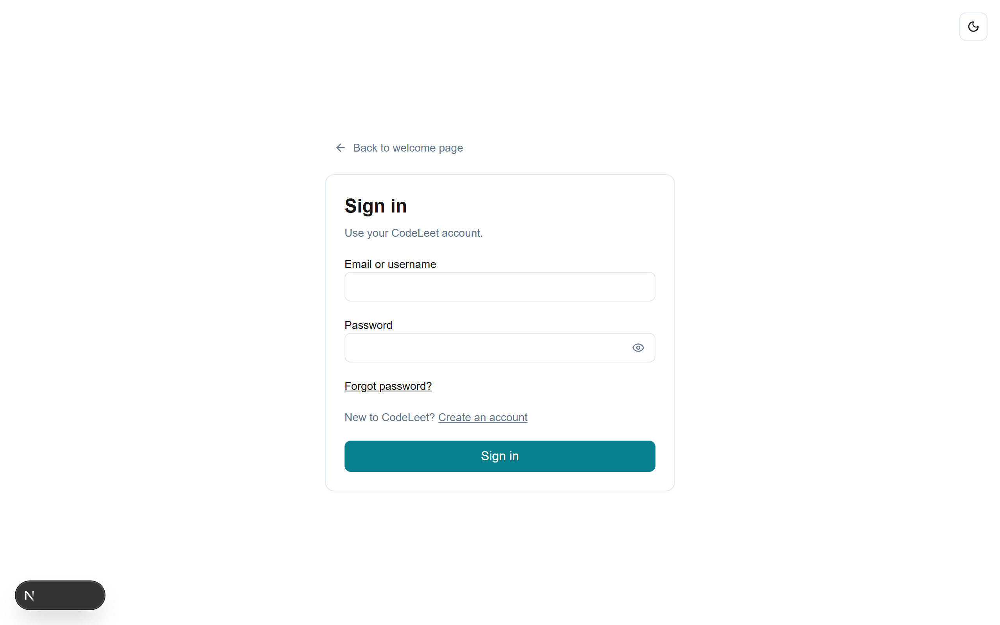

1. **Creating an Account**:
   - Navigate to the welcome page and choose **Create student account** (`/sign-up`).
   - Enter a **Username** (1–80 characters after trimming). Usernames cannot contain `@` or control characters; the app does not restrict them to only letters, numbers, dashes, and underscores.
   - Enter a valid **Email address**, a strong **Password** (minimum 8 characters), and confirm your password.
   - Click the Show/Hide eye icon on either password field to verify your input before submitting.
   - Click **Create account**. All self-service registrations receive the **Student** platform role by default. Instructor and Administrator roles are provisioned by an existing Administrator.
2. **Signing In**:
   - Open **Sign In** (`/sign-in`).
   - You can authenticate using either your registered **Email address** or your unique **Username**.
   - Enter your password and click **Sign in**. If your browser detects a slow network connection, an explicit notice will advise you to keep the window open while your credentials are authenticated.
   - To safeguard accounts against brute-force attacks, repeated failed login attempts temporarily lock the identifier. If you trigger this limit, wait sixty seconds before retrying.
3. **Password Recovery**:
   - If you forget your password, click **Forgot password?** on the sign-in form.
   - Enter your account email and click **Send reset link**. For privacy reasons, the confirmation prompt does not reveal whether the email address is registered in the system.
   - Open the reset link in the same browser, enter your new matching password, and choose **Update password**. Once updated, you can sign in with your new credentials.
4. **Email Verification**:
   - If institution-wide email verification is enabled, open the confirmation link sent to your inbox. The link redirects to `/email-verified`, confirming your email timestamp and redirecting you to your courses.

### 2.2 Profile Settings & Theme Customization

- **Profile Settings**:
  - Students open **Menu → Profile settings** (`/profile`); instructors select **Profile** from the top header navigation.
  - You can update your **Username** at any time. Usernames are unique across the platform (case-insensitive). Whitespace is automatically trimmed.
  - Your primary email and assigned platform roles are displayed as read-only.
- **Light and Dark Mode**:
  - Toggle the moon/sun icon in the top navigation bar to switch between dark and light appearance themes.
  - Your theme preference is preserved across browser sessions in local storage. Switching themes does not reload the page or disrupt active code execution or unsaved editor contents.

---

## 3. Course Workspaces & Lifecycle

CodeLeet partitions all learning activities into self-contained **Course Workspaces**.

### 3.1 Course Roles and Membership

- **Multi-Course Enrollment**: You can be enrolled as a student in one course (e.g., *CS1010 Introduction to Programming*) while serving as an instructor or teaching assistant in another.
- **Canonical Navigation**: URLs in CodeLeet are role-aware. Navigating to `/courses/<courseId>/assignments` or `/courses/<courseId>/submissions` automatically renders the appropriate student or instructor workspace based on your enrolled role in that course, avoiding cluttered URL prefixes.

### 3.2 Course Lifecycle States

1. **Active**: The course is fully operational. Instructors can publish assignments, students can submit revisions, and discussions are open.
2. **Archived**: The course is placed in read-only mode by the course owner. Members can review historical assignments, previous submissions, feedback, and discussion archives, but no new submissions, grade modifications, or posts are permitted.
3. **Legacy**: Preserved historical coursework without defined class boundaries. Legacy courses are archived by default and remain read-only until an administrator assigns a designated course owner.

### 3.3 Course Feature Switches

Course owners and instructors can independently toggle specific course features on the course overview page. Toggling a switch off hides the navigation link and restricts route access, but **never deletes** student submissions, grades, or forum data.

| Feature Switch | When Enabled (Default) | When Disabled |
| :--- | :--- | :--- |
| **Assessments** | Students can view published assignments, run code, execute test cases, submit revisions, view submissions, and check published grades. | Hides assignments and submissions. Historical submission records remain securely stored in the database but are inaccessible to students until re-enabled. |
| **AI Features** | Students can request pedagogical AI feedback; instructors can generate AI rubric suggestions and use Context comparison. | Blocks new AI requests and hides AI navigation/actions. Saved submissions and grades remain available according to their own feature and course access rules. |
| **Discussion Forum** | Enables course-scoped discussion threads, replies, and full-text keyword search. | Hides forum navigation and blocks new threads/replies. Existing forum posts are retained and reappear when re-enabled. |
| **Experience Points (XP)** | Computes and displays earned assignment XP on student dashboards and assignment rows. | Hides XP views and stops new XP awards while disabled. Existing ledger entries are retained; enabling XP again recomputes awards from published grades. |
| **Leaderboard** | Displays real-time course leaderboard ranking students by accumulated XP. | Hides the leaderboard page from students and instructors. Disabling leaderboard does not halt XP earning. |
**My progress is derived navigation, not a separate switch.** It appears while either Assessments or XP is enabled. Assignment, deadline, submission, and grade details depend on Assessments; XP totals depend on XP.

---

## 4. Student User Guide

### 4.1 Browsing Assignments & Deadlines

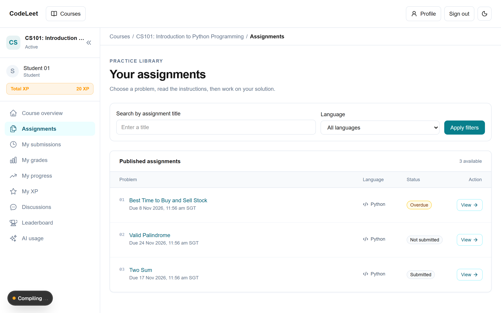

1. Open your enrolled course from the **Courses** page and select **Assignments** in the sidebar.
2. **Filtering Assignments**:
   - **Language Filter**: Filter by **All languages**, **Python**, or **Java**.
   - **Search Box**: Search assignments by keyword in the title.
   - Click **Apply filters** to update the list, or **Clear filters** to reset.
3. **Understanding Due Dates & Status**:
   - All due dates and timestamps in CodeLeet are displayed in **Singapore Standard Time (SGT, UTC+8)**.
   - Assignments display one of four clear status badges:
     - **Not submitted**: You have not saved any revisions yet.
     - **Overdue**: The deadline has passed and you have not submitted a revision. You can still submit your work.
     - **Submitted**: Your latest saved revision was submitted prior to the deadline (or the assignment has no deadline).
     - **Submitted late**: Your latest saved revision was submitted after the posted deadline.
   - *Graceful Policy*: Late submissions are accepted without automated penalty. The exact deadline snapshot that applied at the time of submission is permanently attached to each revision.

### 4.2 Interactive Code Editor

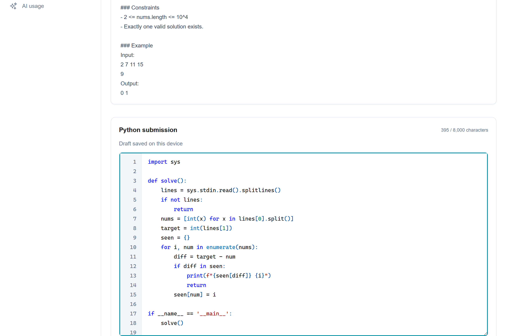

When you open an assignment, the problem instructions and expected constraints are displayed directly above the code editor:
- **Language Lock**: The programming language (Python or Java) is determined by the assignment and cannot be switched.
- **Editor Controls**:
  - Full syntax highlighting for Python and Java.
  - Automatic indentation: Pressing **Tab** indents, **Shift+Tab** unindents, and **Enter** maintains the block indentation level.
  - Multi-line block selection: Highlight multiple lines and press Tab or Shift+Tab to indent/unindent whole code blocks.
  - Accessible focus exit: Press **Escape**, then **Tab**, to move keyboard focus out of the editor pane.
  - Size limitation: Submissions accept up to **8,000 characters** of source code. An indicator alerts you if your source exceeds this limit.

### 4.3 In-Browser Code Execution (Pure Client-Side)

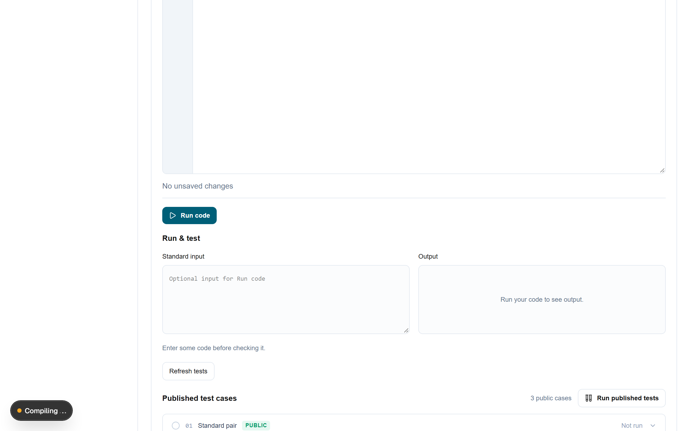

Code runs in a browser sandbox using WebAssembly (Pyodide for Python and TeaVM for Java). Running code does not post your source to a server-side execution endpoint: the browser passes it to an isolated iframe and worker. Runtime assets are loaded from the application as needed, so a run requires access to those assets. Submitting a revision sends its source to the application server; requesting AI feedback also sends the saved source through the server to SoCLaaS.

1. **Running Code**:
   - Provide optional **Standard input** in the stdin panel if your program reads input via `input()` (Python) or `Scanner` / `BufferedReader` (Java).
   - Click **Run code**.
   - The compiled output and standard error streams appear in the **Output** terminal below the editor.
2. **Runtime Constraints & Supported Features**:
   - **Input limit**: Standard input accepts up to **4,096 UTF-8 bytes**.
   - **Output limit**: Output capture is capped at **8,192 bytes** per execution to prevent browser freezing.
   - **Execution timeout**: Individual runs enforce a **5-second wall-clock deadline**. Long-running loops or blocking calls will terminate with a timeout notification.
   - **Java Compatibility**: The browser runner compiles Java source and supports common APIs including `Scanner`, `BufferedReader`, collections, and `System.out`. Multi-threading primitives (`Thread.start()`, `join()`, `Thread.sleep()`) are not supported. Other library behavior depends on the bundled TeaVM class library.
   - Running code verifies execution locally but does not submit your assignment or record a grade.

### 4.4 Validating with Practice Tests

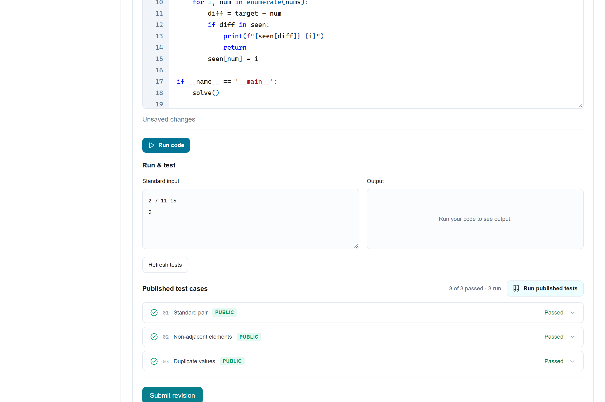

Instructors can author and publish test cases (up to 25 total cases per assignment, marked as public or private):
1. In the right-hand panel, select the **Test cases** tab to inspect all published test cases.
2. Expand any test case to view its **Input** and **Expected Output**.
3. Click **Run published tests**:
   - The browser executes your active editor code against each public test case sequentially.
   - Each test case displays its result, including **Passed**, **Wrong output**, **Compile error**, **Runtime error**, **Time limit exceeded**, or **Output limit exceeded** when applicable.
   - For wrong outputs, a side-by-side diff compares your actual stdout with the expected output. Note that comparison converts line endings (`\r\n` to `\n`) and strips at most one terminal newline, but preserves trailing spaces on lines. Ensure your output matches the exact format and does not include extraneous trailing spaces.
4. Click **Refresh tests** to reload any newly updated test cases from your instructor.

### 4.5 Autosave & 7-Day Local Draft Recovery

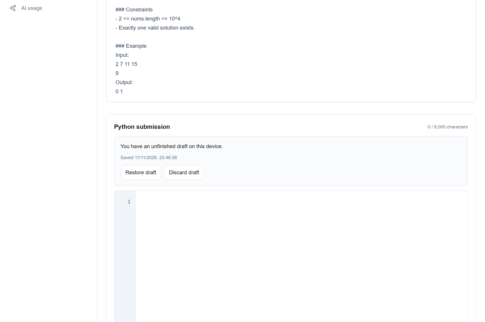

Never lose your work due to accidental browser closures, battery failures, or network drops:
- **Automatic Debounced Autosave**: As you type, CodeLeet automatically persists your draft to your device's browser storage after a 500-millisecond typing pause. A subtle status pill confirms **Draft saved on this device**.
- **7-Day Retention**: Local drafts are retained for **7 days**, supporting up to 10 distinct assignment drafts simultaneously on your browser.
- **Draft Recovery Banner**: When you reopen an assignment with a saved local draft, a recovery prompt offers:
  - **Restore draft**: Immediately restores your unsaved code to the editor.
  - **Discard draft**: Clears the saved local copy and resets the editor to the baseline template or last submitted revision.
- **Multi-Tab Conflict Protection**: If you edit the same assignment in two separate browser tabs, CodeLeet detects the conflict and asks whether you wish to **Load other tab's draft** or **Keep this tab's code**.
- *Important*: Signing out of CodeLeet securely clears local drafts on shared workstations.

### 4.6 Submitting Revisions & Managing History

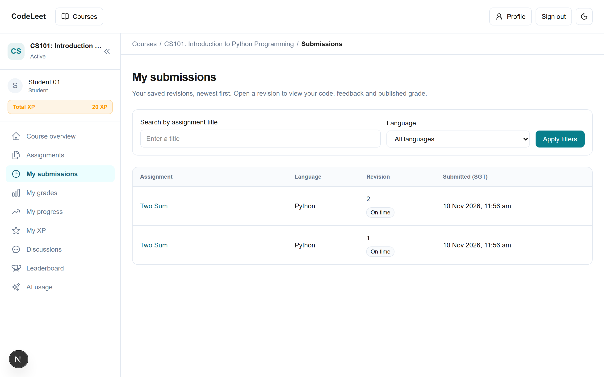

1. When you are ready to submit your solution, click **Submit revision**.
2. Submissions are **immutable snapshots**. Each submission is stamped with an incrementing revision number (e.g., Revision 1, Revision 2), submission timestamp (SGT), and deadline adherence status.
3. **Submissions List** (`/courses/<courseId>/submissions`):
   - Displays all historical revisions in reverse chronological order (up to 25 entries per page).
   - Filter submissions by assignment title or programming language.
   - Click any submission row to inspect the frozen source code, view instructor grades/feedback, or continue editing.
4. **Continue Editing**:
   - To make further improvements, open any previous revision and click **Continue editing**. This loads that revision's source into the active editor while preserving the historical record intact.

### 4.7 Revision Comparison

1. From any saved submission view, select **Compare revisions**.
2. Select your **From revision** and **To revision** (the initial comparison uses the selected revision and its preceding revision when available).
3. The comparison table shows changed lines with separate from/to line numbers; additions are green (`+`) and removals are red (`−`).
4. Comparing identical revisions confirms **No changes between these revisions**. The server loads only your authorized revisions for the comparison page.

### 4.8 Requesting Pedagogical AI Feedback

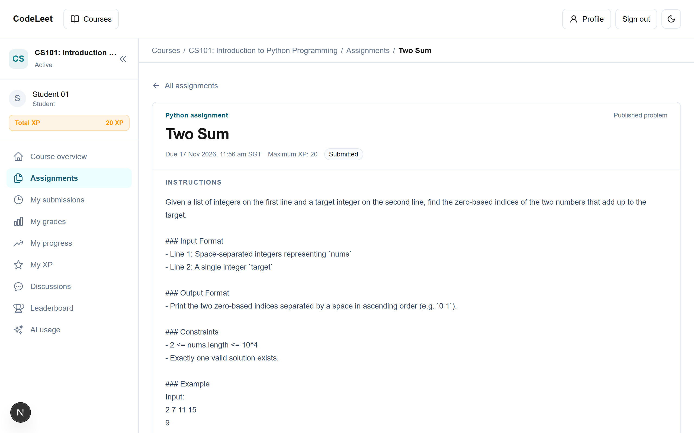

1. On any saved submission page, locate the **Learning feedback** panel and click **Request review**.
2. CodeLeet contacts the secure backend pedagogical AI service (SoCLaaS) and returns a structured tutoring review consisting of:
   - **Executive Summary**: High-level assessment of your code's approach.
   - **Key Strengths**: Specific programming patterns, modular structures, or algorithmic efficiencies you did well.
   - **Areas for Improvement**: Constructive guidance on edge cases, readability, and performance.
   - **Guiding Questions**: Socratic questions to prompt deeper thinking without simply giving away the answer.
3. *Pedagogical Guardrails*: The AI does not have access to private instructor grading rubrics, cannot execute code, and cannot award grades or XP. Use the feedback to reflect on your code and submit an improved revision!

### 4.9 Student Progress Dashboard

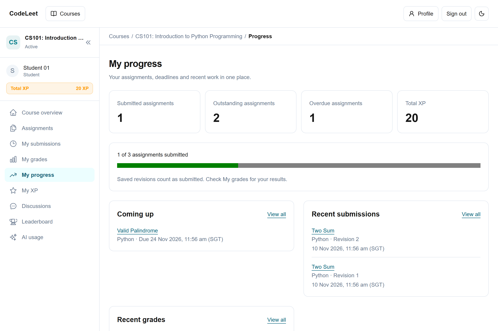

Navigate to **My progress** (`/courses/<courseId>/progress`) from the course sidebar to view an overview of your academic standing:
- **Metrics Overview Cards**:
  - **Submitted assignments**: Number of published assignments where you have submitted at least one revision.
  - **Outstanding assignments**: Assignments that require your submission.
  - **Overdue assignments**: Outstanding assignments whose posted deadlines have passed.
  - **Total Earned XP**: Cumulative experience points awarded in this course.
- **Coming Up (Deadlines)**: Displays the 5 closest upcoming assignment deadlines in chronological order.
- **Recent Submissions & Recent Grades**: Quick links to your 5 most recent submissions and released grade reports.
- *Completion Counts*: The server loads published assignment and submission data for the current student and derives completion per assignment, so multiple revisions do not count as multiple completed assignments.

### 4.10 Discussion Forums & Keyword Search

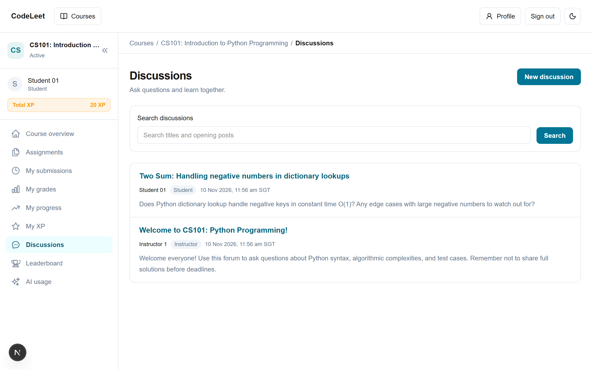

1. Open **Discussions** (`/courses/<courseId>/forums`) from the course sidebar.
2. **Browsing Discussions**: View threads sorted by creation date, showing author username, role badge, post count, and timestamp.
3. **Searching Threads**: Enter keywords in the **Search discussions** bar. The search performs case-insensitive matching across thread titles and opening post messages.
4. **Creating a Discussion**:
   - Click **New discussion**.
   - Enter a descriptive **Title** (up to 160 characters) and your **Message** (up to 8,000 characters).
   - CodeLeet renders text securely without dangerous script execution.
5. **Replying**: Open any thread and enter your response in the **Your reply** box, then click **Post reply**.
6. *Rate Limiting*: Forum actions enforce an anti-spam rate limit of 10 posts per minute per user.

### 4.11 Course Leaderboard & Experience Points (XP)

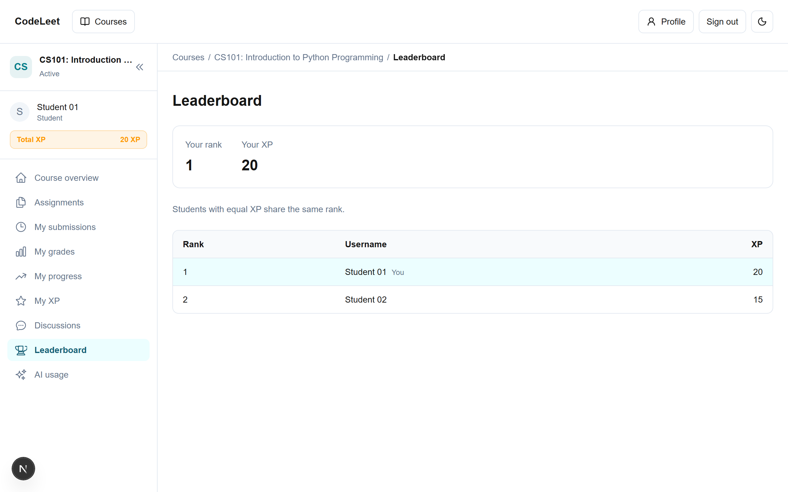

- **How XP is Earned**: XP is awarded when an instructor publishes a grade on your assignment:
  `Awarded XP = floor((Student Score / Rubric Maximum) * Assignment Maximum XP)`
  For example, earning 8 out of 10 points on an assignment worth 100 XP awards `floor((8 / 10) * 100) = 80` XP. Saving additional revisions does not grant duplicate XP.
- **Course Leaderboard** (`/courses/<courseId>/leaderboard`):
  - Displays all students with positive earned XP ranked in descending order.
  - **Standard Competition Ranking (1, 1, 3)**: Students with tied XP share the same rank. For example, if two students tie for 1st place, both are ranked #1, and the next student is ranked #3.
  - **Your Ranking Pin**: Your personal rank and XP total are pinned at the top of the leaderboard so you can immediately see your standing regardless of the active page.
  - Students with 0 XP are classified as **Unranked** until their first grade is published.

---

## 5. Instructor User Guide

### 5.1 Course Roster & Student Join Code Management

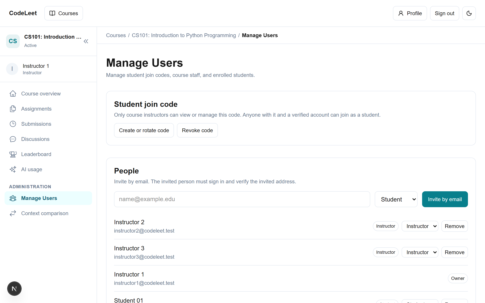

1. In your taught course, select **Manage Users** (`/courses/<courseId>/manage-users`) under the **Administration** sidebar section.
2. **Student Join Code**:
   - An active course can have a random URL-safe **Student join code**. Generated codes contain 32 characters.
   - Click **Copy join code** to distribute it to students in your class. Students can input this code on their Courses page to immediately enroll.
   - Click **Rotate code** if you need to revoke the previous code and issue a fresh one.
3. **Managing the Roster**:
   - The **People** table lists all enrolled members with their display name, email, enrolled role, and join date.
   - To invite members directly, enter their email address, select their course role (**Student** or **Instructor**), and click **Invite member**.
   - Click **Remove** next to any student row to unenroll them from the course.

### 5.2 Assignment Authoring & Rubric Builder

1. Navigate to **Assignments** and click **New assignment** (`/courses/<courseId>/assignments/new`).
2. **Assignment Configuration**:
   - **Title**: Enter a clear problem title (e.g., *Two Sum II - Input Array Is Sorted*).
   - **Language**: Select **Python** or **Java**. Once a student submits a revision, the language becomes permanently locked to prevent submission corruption.
   - **Instructions**: Author clear problem statements, input/output requirements, and algorithmic constraints.
   - **Due Date & Time**: Set an optional deadline in **Singapore Standard Time (SGT)**. Leave blank for self-paced assignments.
   - **Maximum XP**: Assign an XP reward (0 to 100,000 XP). Set to 0 if the assignment should not award leaderboard XP.
3. **Private Rubric Builder**:
   - Click **Add criterion** to build 1 to 20 private evaluation criteria.
   - For each criterion, specify a **Criterion Title** (e.g., *Algorithmic Correctness*, *Time Complexity*, *Code Style*), **Maximum Points**, and detailed grading descriptors.
   - *Rubric Privacy*: Rubric criteria descriptions and maximum point allocations remain strictly confidential to instructors until an evaluation is explicitly published.
4. **Publication Status**:
   - Save as **Draft** to continue editing privately. Draft assignments are completely invisible to enrolled students.
   - Select **Published** when the assignment is ready for student access.

### 5.3 Instructor Student-Perspective Preview Mode

1. On any assignment card in the instructor assignment list, click **Preview** (or append `?preview=1` to the assignment URL).
2. A banner confirms: **Instructor Preview Mode — Experiencing assignment as a student**.
3. In preview mode, you can interact with the student code editor, test in-browser execution with standard input, and run published practice test cases. Submission buttons are safely disabled in preview mode.
4. Click **Exit preview** or navigate without the preview flag to return directly to the assignment editor.

### 5.4 Public Practice Test Authoring

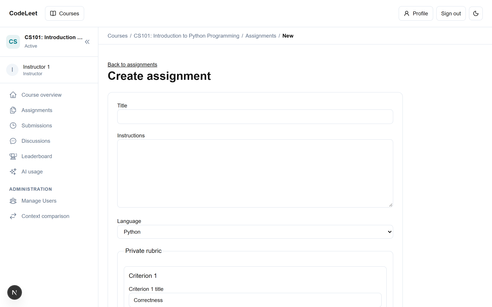

1. From the assignment editor or assignment card, open **Practice tests** (`/courses/<courseId>/assignments/<assignmentId>/practice-tests`).
2. Click **Add test case** (instructors can configure up to **25 cases** per assignment):
   - **Name**: 1–120 characters (e.g., *Example 1: Basic positive integers*).
   - **Input**: Enter exact standard input string (up to 4,096 bytes).
   - **Expected Output**: Enter expected stdout string (up to 8,192 bytes).
   - **Visibility**: Toggle between **Public** (immediately available to enrolled students for in-browser practice testing) and **Private** (reserved for instructor-only evaluation during submission review).
3. **Atomic Publication Workflow**:
   - **Save draft**: Saves test cases in your private instructor workspace without exposing them to students.
   - **Publish tests**: Atomically publishes public cases for student practice. Private cases remain in the instructor's saved set and are available in the instructor submission-review runner; they are not sent to students.
   - **Unpublish tests**: Retracts published cases while retaining your saved draft.

### 5.5 Submission Review, AI Rubric Suggestions & Grade Publishing

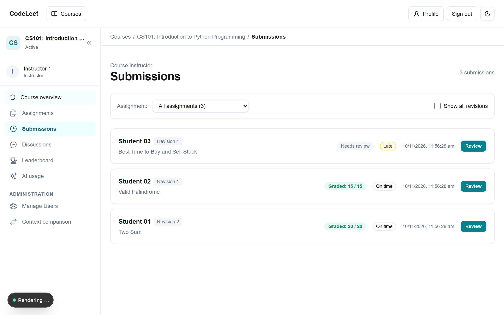

1. Open **Submissions** in your course to browse all student revisions.
2. Select any student revision to open the **Submission Review & Grading** workspace:
   - Inspect the student's submitted code with full syntax highlighting.
   - Check the exact submission timestamp and deadline adherence badge (On time / Late).
   - Click **Run code** to test the student's code locally in your browser.
3. **AI Rubric Suggestions**:
   - Click **Request review** under the *AI Rubric Suggestions* card.
   - The server analyzes the student's source code against your private rubric criteria and returns suggested scores and constructive rationale for each criterion.
   - *Human in the Loop*: AI suggestions are strictly advisory. The AI cannot publish grades or alter student scores directly.
4. **Manual Grading & Publishing**:
   - Adjust the score and feedback for each rubric criterion.
   - Enter overall **Instructor feedback**.
   - Click **Save draft** to keep your evaluation private.
   - To release grades to the student, check **Publish this grade to the student** and click **Save and publish**.
   - Once published, the student's progress dashboard, personal grade view, and XP leaderboard update immediately.

### 5.6 AI Context Comparison Inspector

Instructors can open **Context comparison** (`/courses/<courseId>/context-comparison`) under **Administration**. It runs focused and broader owner-authorized reviews for a selected submission and displays their estimated input-token counts, suggested evaluations, and the per-comparison token difference. Uncached model runs consume instructor quota. The separate offline context experiment measured an 18.1% aggregate token reduction across eight synthetic cases; an individual comparison can differ, and that experiment did not measure model-quality improvements.

---

## 6. Platform Administrator User Guide

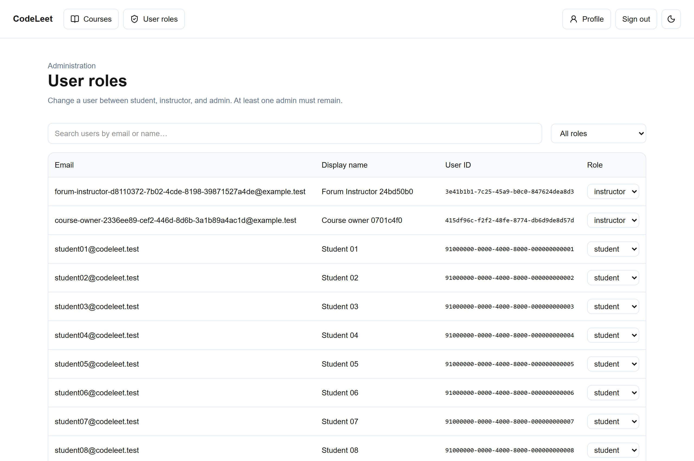

### 6.1 User Roles Governance (`/admin`)

1. Platform Administrators have access to the dedicated **User roles** portal in the top navigation bar.
2. **Directory View**:
   - Displays all registered users across the platform with their **Username**, **Email**, **Platform Role** (*Student*, *Instructor*, or *Administrator*), and account creation timestamp.
3. **Role Elevation & Demotion**:
   - Click the role selector dropdown next to any user account to update their platform role.
   - Promoting a user to **Instructor** grants them authority to create new courses and author assignments.
   - Promoting a user to **Administrator** grants full platform governance privileges.
4. **Last-Admin Safeguard**:
   - The platform strictly enforces an immutable safety guard preventing the demotion or deletion of the last remaining Administrator. If an administrator attempts to demote their own account when no other active administrators exist, the action is rejected with an explanatory error.

### 6.2 Institutional Course Inspection

- Administrators can inspect all courses across the institution, including active and archived workspaces.
- In unowned historical courses (such as the *Legacy* course), administrators can assign an initial course owner to reinstate course management.

---

## 7. Action Effects & Behavior Matrix

The following comprehensive matrix specifies the trigger, immediate UI feedback, backend mutation, and edge case recovery for every key action across CodeLeet:

| User Action | Immediate UI Feedback | Backend / Storage Mutation | Edge Case / Error Recovery |
| :--- | :--- | :--- | :--- |
| **Sign In** | Submit button shows spinner and **Signing in…**; form fields become disabled. | Authenticates credentials; establishes secure HTTP-only session cookie. | If invalid credentials, displays alert; if locked by rate limit, displays countdown timer to retry. |
| **Theme Toggle** | Immediate CSS color transition between light and dark themes. | Stores the preference in browser `localStorage` when available; otherwise the choice lasts for the current page session. | Initial theme uses the stored preference or system color scheme. |
| **Run Code** | Button shows pending state; terminal reports runner output. | Passes source and stdin from the page to the opaque browser iframe/worker runtime. Runtime assets load from the app origin; source is not posted to an execution API. | Standard assignment runs use a 5-second limit; the runner also reports preparation, output, unavailable, and stopped states. |
| **Run Practice Tests** | Test case pills switch to loading spinner; displays **Running test case X of Y…**. | Sequentially runs code against public inputs inside client-side sandbox. | Normalizes line endings (`\r\n` vs `\n`); displays visual diff if stdout does not match. |
| **Type in Editor** | Typing status pill shows **Saving draft…**, debounced by 500ms, then **Draft saved on this device**. | Writes source to browser `localStorage` keyed by `draft:userId:assignmentId`. | If browser storage quota is exceeded, displays **Couldn't save draft on this device; submit revision soon**. |
| **Restore Draft** | Editor replaces baseline template with the recovered 7-day draft; recovery banner dismisses. | Local state only. | If user clicks **Discard draft**, local storage key is deleted and template restored. |
| **Submit Revision** | Button shows spinner; disabled to prevent double clicks; toast confirms **Revision N submitted**. | Creates immutable database row in `submissions`; snapshots current deadline and assignment language. | If source exceeds 8,000 characters, returns validation error; draft remains in editor for trimming. |
| **Compare Revisions** | Comparison table displays changed lines and from/to line numbers. | Loads the student's authorized revisions on the server and renders their comparison. | If comparing identical revisions, displays **No changes between these revisions**. |
| **Request Student AI Feedback** | Button shows spinner and **Analyzing submission…**; skeleton loader pulses. | Dispatches request to server-side SoCLaaS API; records token usage in ledger. | If AI quota exhausted or service down, displays friendly retry toast; submission is never altered. |
| **Post Discussion Thread** | Button shows spinner; redirects to newly created thread on success. | Inserts row into `forum_threads` table; validates 160-char title and 8,000-char message. | If exceeding 10 posts/minute rate limit, displays **Posting too quickly; wait a minute**. Draft preserved. |
| **Rotate Join Code** | Join-code control shows pending state; a new code appears with a copy action. | Stores a hash of the generated code in `course_join_codes`; invalidates the previous active code. | Previous code stops accepting enrollments; existing students are unaffected. A verified account is required to join. |
| **Publish Assignment** | Status badge switches from gray **Draft** to green **Published**. | Updates `is_published = true` in database; triggers assignment visibility for enrolled students. | Language field is locked against future modifications once first student submission is saved. |
| **Publish Practice Tests** | Toast confirms the action; published public cases appear for students after refresh. | Atomically writes the published public-case snapshot to `assignment_practice_sets`; the instructor draft retains public and private cases. | Private cases are not published to students. Version conflicts require reloading the current draft. |
| **Publish Grade & Rubric** | Button shows pending state; published grade appears to the student and eligible XP is recomputed. | Sends a version-checked grade update; the database operation updates the grade and XP ledger atomically. | On version conflict, instructor must reload before saving again. |
| **Toggle Feature Switch** | The control shows pending state; navigation reflects the saved setting after refresh. | Updates the course's row in `course_features`. | If saving fails, the prior value remains and an error is shown. |
| **Demote Admin User** | Role selector displays spinner; table updates with new role badge. | Updates `user_roles` table with platform role change. | Rejects with **Cannot demote the last remaining administrator** if last admin. |

---

## 8. Troubleshooting & Frequently Asked Questions (FAQ)

### Frequently Asked Questions

#### Q1: Why do I see "Overdue" when I haven't submitted, and can I still submit?
**A**: CodeLeet does not lock assignments when the deadline passes. You can still submit your work; the submission will simply be marked with a yellow **Submitted late** badge. CodeLeet does not apply automated penalties, leaving grading discretion to your instructor.

#### Q2: My code passed all public practice tests, but my final grade was lower. Why?
**A**: Public practice tests are intended for basic syntax and sanity validation. Instructors evaluate submissions against comprehensive private rubric criteria and private edge-case test suites.

#### Q3: Does running my code or requesting AI feedback submit my assignment?
**A**: **No.** Running code and requesting AI feedback are purely developmental aids. To submit your work for official grading, you must explicitly click the **Submit revision** button.

#### Q4: I closed my browser tab and my code disappeared. How do I get it back?
**A**: Reopen the assignment in the same browser. CodeLeet will detect your autosaved local draft and display the **Restore draft** prompt. Simply click **Restore draft** to recover your code.

#### Q5: Can I see what changes I made between two submissions?
**A**: Yes! Open any submission in **My submissions** and click **Compare revisions**. Select the two revision numbers you wish to compare to view an interactive color-coded diff.

### Troubleshooting Guide

| Issue Encountered | Probable Cause | Recommended Resolution |
| :--- | :--- | :--- |
| **"Sign-in locked / Too many attempts"** | The identifier or global sign-in attempt limit was reached in the current minute. | Wait for the displayed retry time (up to 60 seconds), then retry. Attempts are counted before credential validation. |
| **"Couldn't save draft on this device"** | Browser storage is disabled, full, or running in an incognito session with strict storage blocking. | Check that cookies and local storage are enabled for `localhost` / CodeLeet origin. Submit your revision promptly to save it to the server. |
| **"Draft conflict detected"** | The same assignment was edited in multiple browser tabs simultaneously. | Choose **Keep this tab’s code** or **Load other draft** to resolve the conflict. |
| **"Java compiler error: Thread is not supported"** | Java multi-threading APIs (`Thread`, `join`, `sleep`) are unsupported in the client-side WebAssembly environment. | Refactor your program to use sequential execution and standard iteration structures. |
| **"Wrong Output" on practice tests despite identical numbers** | Mismatched whitespace, missing line breaks, or unwanted debug print statements. | Verify that your program matches the exact expected output format. Remove extraneous debug logs and check for trailing spaces. |
| **Course sidebar links (e.g. Discussions or Leaderboard) disappeared** | The course instructor or owner has disabled that specific feature switch for the course. | Contact your course instructor. Existing posts and earned XP remain safely preserved in the database. |
| **Password reset email not received** | Email may be filtered or you may be testing in a local development environment. | Check your spam folder. In local development environments, outgoing emails are captured in the local [Mailpit interface](http://localhost:54324). |
