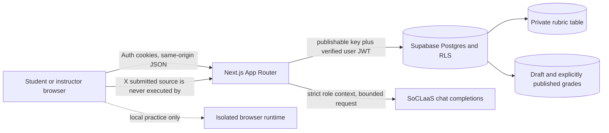
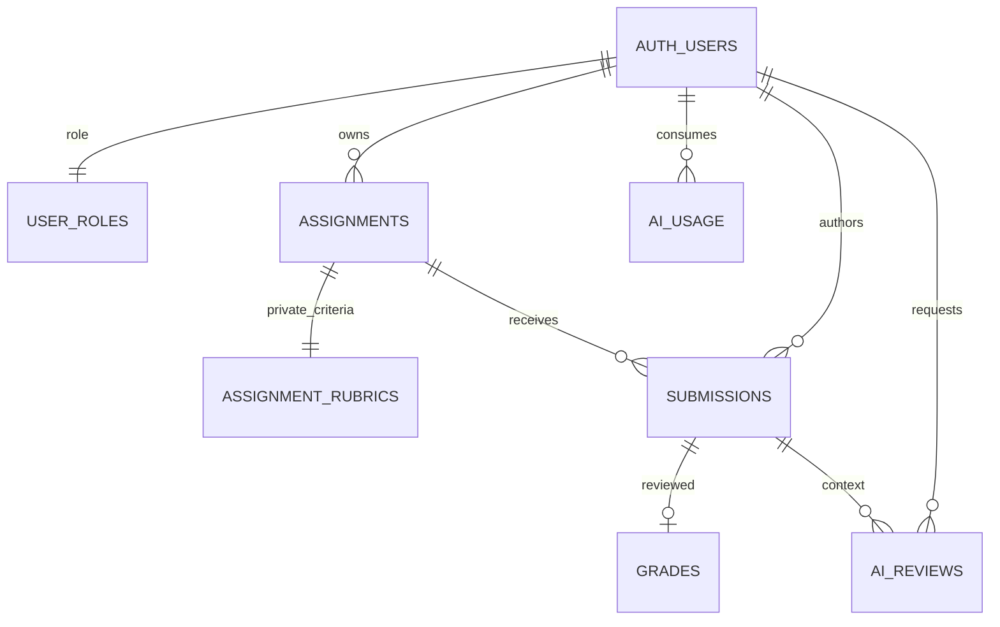

# CodeMentor MVP evidence

This record separates code and local checks from hosted-provider and deployment evidence. No real student records or submitted code are used here.

## Architecture and trust boundaries

Public signup assigns `student` in the database trigger. Instructor access is granted by trusted administration. The app validates the authenticated user with `getUser()` and reads the protected role table. RLS is the second authorization boundary. Rubrics are physically separated from student-readable assignment rows. AI receives a submission only after server-side ownership checks. Grade publication is a separate instructor-controlled RPC.

## Threats and checks

| Threat | Mitigation | Evidence/check |
| --- | --- | --- |
| Student forges instructor role | signup trigger ignores user metadata; role table has no client write grants | `supabase/tests/database/accounts_and_access.test.sql` |
| Student reads private rubric or another student's submission/grade | separate rubric table, owner helper, row-level policies and limited grants | `supabase/tests/database/codementor_mvp.test.sql` |
| Duplicate revisions or replay conflict | user/assignment advisory lock and request ID constraints | pgTAP idempotency assertions |
| Concurrent AI quota overspend | transaction advisory lock, pending reservations, UTC limits | pgTAP reservation-boundary assertions and a local 12-request concurrent harness (5 accepted, 7 rejected) |
| Prompt injection in source | source is JSON-serialized into user data; fixed system text; no tools | 15 synthetic context tests; not proof of model resistance |
| Malformed output or XSS | strict Zod output schemas and plain React text rendering | Vitest contract tests |
| Provider secret leaks | server-only client, secret never returned, AI disabled by default | mocked SoCLaaS route/client tests and source-level server-only boundary |
| Cross-user cache disclosure | SHA-256 key includes user/task/source/version/model; owner RLS | pure key-scope tests and RLS policies |
| Overlarge prompt/source | 8,000-character submission schema and preflight prompt estimate | Vitest contract tests |
| External execution | no server execution endpoint; existing practice runtime remains a separate browser-only local flow | repository source inspection and existing runtime boundary suite |

## Context experiment

`node workflow/scripts/run-context-experiment.mjs` produces ten synthetic input-size comparisons. It makes zero provider calls. Live SoCLaaS response quality and attack testing are pending the team's authorized key/model and network access. The instructor context comparison page uses only an owned assignment, its rubric, and the selected submission; two uncached strategies use two daily instructor quota slots.

## Local checks recorded

Verified on the implementation tree under Node `v24.16.0` and pnpm `12.15.0`; repository configuration pins Node `24.22.1` in `.node-version`. The configured patch version was not installed in this environment.

- `pnpm lint`, `pnpm format:check`, `pnpm typecheck`, and `pnpm build`: passed.
- `pnpm test:unit`: 65 tests passed across 9 files.
- `pnpm db:reset`: passed; local migrations applied. `pnpm db:test`: 33 assertions passed across two pgTAP files.
- `pnpm test:e2e`: 18 passed, 4 skipped (the optional browser-runtime suite); the authenticated student and instructor journey uses local Supabase and mocked AI. The local journey was explicitly enabled with the local public URL/key and test-only service key supplied in process memory; none were saved or printed.
- Local quota concurrency harness: 12 simultaneous synthetic requests, 5 accepted and 7 correctly rejected at the configured cap.
- OpenSpec strict change/spec validation, scaffold check, and `git diff --check`: passed.
- Ten-case context experiment: generated synthetic size estimates; zero provider calls, so it does not establish model quality or safety.
- Four opt-in browser-runtime tests were skipped. No live SoCLaaS request, hosted Supabase, Vercel configuration, deployment, or external integration check is claimed.

## External gates

No hosted Supabase or Vercel environment has been configured. SoCLaaS credentials/network are not verified. AI remains off unless explicit server-side configuration is present. Do not use real student records for the synthetic experiment. The local E2E build was produced with local public Supabase settings available only to the build process; no `.env.local` or credential file was created. Checks ran against this working tree before final commit creation.
